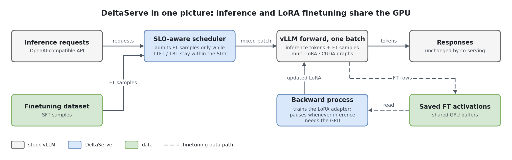
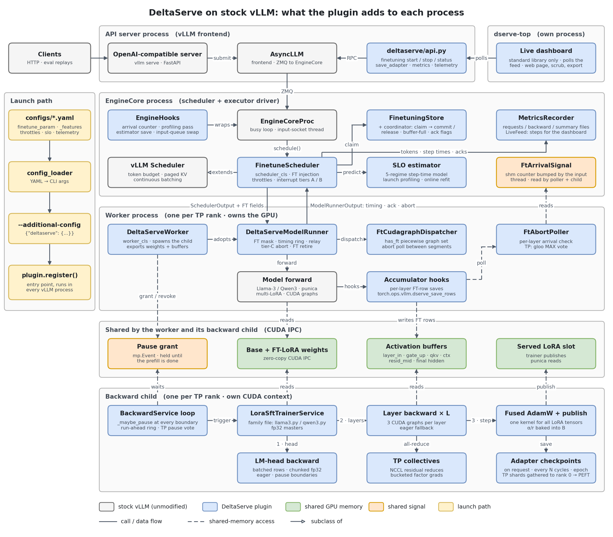

# DeltaServe-vLLM

**Co-serving LLM inference and LoRA finetuning on the same GPUs, as a plugin for
stock vLLM.**

DeltaServe runs a LoRA supervised-finetuning (SFT) job *inside* a live inference
server. Each step it slips finetuning (FT) samples into the inference batches and
records their activations during the forward pass. A backward process on the same
GPU then trains a dedicated LoRA adapter from those activations. An SLO-aware
scheduler decides, step by step, how much FT work to admit so that inference
time-to-first-token (TTFT) and time-between-tokens (TBT) stay within their SLOs.

This repo re-hosts DeltaServe's co-serving layer on vLLM's V1 engine. vLLM already
provides the inference side: multi-LoRA batching (punica kernels), paged KV,
continuous batching and the multi-process engine. DeltaServe adds what vLLM does
not have:

- **Activation capture:** FT rows are saved during the forward pass.
- **Backward process:** one per GPU, with a hand-written LoRA backward and CUDA graphs.
- **SLO-aware admission scheduler:** with a step-time estimator.
- **Pre-emption and pause machinery:** keeps inference latency protected.
- **Adapter routing** (optional, off by default): a request may leave the choice of
  adapter to the server, and a finished finetuning job publishes its adapter into the
  pool that choice is made from ([more](#adapter-routing)).
- **Training outputs:** the trained adapter is saved on request or periodically as a
  standard PEFT LoRA (merged across TP ranks), `GET /finetuning_status` reports
  progress, and system metrics (TTFT / TBT, inference and FT throughput, GPU time
  split, per-step LoRA time, memory per GPU) are recorded on launch. Failures stop the launch or switch finetuning off with a
  reason; they never hang the server or train silently wrong.

All of it ships as a **vLLM general plugin** (`deltaserve`, in `deltaserve-plugin/`).
**vLLM itself is unmodified:** `vllm-upstream/` is a git submodule pinned at
the
[`v0.34.0`](https://github.com/vllm-project/vllm/releases/tag/v0.34.0) release
(`62d4bc3c7`), with no patches. Co-serving is enabled per launch through
vLLM's own `--additional-config`. Without it, the server is plain vLLM.
(v0.33.0 still works with the same plugin: it is the last release with vLLM's v1
model runner, and `finetune_features.model_runner` picks between the two there.)

---

## Contents

1. [Get started](#get-started)
2. [How it works](#how-it-works)
3. [Supported models](#supported-models)
4. [Finetuning jobs and adapter routing](#finetuning-jobs-and-adapter-routing)
5. [Implementation](#implementation)
   - [Forward pass](#forward-pass)
   - [Backward pass](#backward-pass)
   - [Step, backward batch and per-step sizes](#step-backward-batch-and-per-step-sizes)
   - [CUDA graphs at a glance](#cuda-graphs-at-a-glance)
   - [Interrupts and pauses](#interrupts-and-pauses-protecting-inference-latency)
   - [Throttles and admission control](#throttles-and-admission-control) — tuning guide: [TUNING.md](TUNING.md)
   - [Optimizations](#optimizations)
6. [Features](#features)
   - [Telemetry and live monitoring (`dserve-top`)](#telemetry-and-live-monitoring-dserve-top)
   - [Adapter routing](#adapter-routing)
7. [Repository layout](#repository-layout)
8. [Installation](#installation)
9. [Launching a server](#launching-a-server)
    - [HTTP endpoints](#http-endpoints)
    - [Saving the trained adapter](#saving-the-trained-adapter)
    - [When something fails](#when-something-fails)
10. [Running experiments](#running-experiments)
11. [Tests](#tests)

---

## Get started

The shortest path from a fresh clone to a co-serving server on one GPU
(Qwen3-0.6B). Every step links to its full section below.

**1. Clone** with the pinned vLLM submodule:

```bash
git clone --recurse-submodules https://github.com/852866031/DeltaServe-vLLM.git
cd DeltaServe-vLLM
```

**2. Install** vLLM v0.34.0 (precompiled kernels, no CUDA build) and the plugin into
a fresh env. On an RTX 5090, use the [RTX 5090 steps](#rtx-5090-blackwell-sm_120)
instead (it needs CUDA 13 inside the env first).

```bash
conda create -n deltaserve python=3.12 -y && conda activate deltaserve
pip install uv
cd vllm-upstream
VLLM_VERSION_OVERRIDE=0.34.0 \
    VLLM_PRECOMPILED_WHEEL_COMMIT=62d4bc3c7e33b1b6c906e233e6af2d3506c482ca \
    VLLM_USE_PRECOMPILED=1 \
    uv pip install --editable . --torch-backend=auto
cd ..
uv pip install --editable deltaserve-plugin --no-deps
pip install peft datasets pandas matplotlib
uv pip uninstall torchaudio     # vLLM pins a torchaudio built for an older torch
```

**3. Download the model.** The launchers run with `HF_HUB_OFFLINE=1`, so fetch the
weights once:

```bash
export HF_HOME=$HOME/hf-cache
huggingface-cli download Qwen/Qwen3-0.6B-Base
```

**4. Build the LoRA adapters.** The repo ships only their configs; the weights
(an inference adapter and the `-ft` copy the backward trains) are built locally in a
few minutes:

```bash
python scripts/init_adapters_qwen3.py --size 0.6b
```

**5. Check the install** (CPU only, a few seconds), then **launch** a co-serving
server from the Qwen3-0.6B template ([`configs/template_qwen3_0.6b.yaml`](configs/template_qwen3_0.6b.yaml),
every setting commented). Finetuning starts as soon as the server is up:

```bash
python tests/test_phase1_step1.py
python eval-tp/launch_deltaserve.py --config configs/template_qwen3_0.6b.yaml --hf-home $HF_HOME
```

**6. Send a request** from another shell. The server log prints one
`[backward] … loss=…` line per training cycle while it serves:

```bash
curl -s localhost:8000/v1/completions -H 'content-type: application/json' \
     -d '{"model": "qwen3-0.6b-toy-lora", "prompt": "The capital of France is", "max_tokens": 16}'
```

**7. Watch training and save the result.** The adapter being trained lives in GPU
memory until you save it:

```bash
curl -s localhost:8000/finetuning_status          # backwards done, tokens, loss, epoch
curl -s -X POST localhost:8000/save_adapter       # → checkpoints/qwen3-0.6b/manual-<time>/
```

The template also saves on its own (every 500 backward cycles and after each epoch,
under `checkpoints/qwen3-0.6b/`) and logs every backward cycle to
`logs/qwen3-0.6b/bwd_log.csv`. A saved directory is an ordinary LoRA adapter: serve it
with `vllm serve Qwen/Qwen3-0.6B-Base --enable-lora --lora-modules sft=<dir>`, load it
with PEFT, or set it as `finetune_param.finetuning_lora_path` to keep training
([details](#saving-the-trained-adapter)).

**Next:** the Qwen3-14B TP=2 template (`configs/template_qwen3_14b_tp2.yaml`, two
GPUs), the [timeline benchmarks](#running-experiments) and the [tests](#tests).

---

## How it works



Inference requests and finetuning samples go through **one** scheduler, which
packs FT samples into inference batches only while the latency SLOs allow it. The
forward pass serves both. For FT samples it also saves their activations, from
which a separate backward process trains the LoRA adapter, yielding the GPU
whenever inference needs it. The trained adapter is published back into the
server.

**In detail** — what the plugin adds to each vLLM process:



<sub>Editable sources: [`docs/figures/overview.drawio`](docs/figures/overview.drawio),
[`docs/figures/architecture.drawio`](docs/figures/architecture.drawio)
(open in draw.io / diagrams.net). Regenerate the PNG/SVG with
`python docs/figures/make_overview.py` / `make_architecture.py`.</sub>

vLLM runs three kinds of processes. DeltaServe adds a fourth, the backward child.
The plugin's entry point, `deltaserve.plugin:register`, is declared under
`vllm.general_plugins`, so vLLM calls it in **every** process. It changes nothing
unless the launch carries `--additional-config '{"deltaserve": {...}}'`. When it
does, `register` wraps a handful of upstream methods and selects DeltaServe's own
worker and scheduler classes through vLLM's existing `worker_cls` / `scheduler_cls`
config fields.

| Process | Stock vLLM | What DeltaServe adds | Seam (how it plugs in, no vLLM edit) |
|---|---|---|---|
| **API server** | OpenAI server, `AsyncLLM` | `/start_finetuning`, `/stop_finetuning`, `/finetuning_status`, `/system_metrics`, `/save_adapter`, `/save_estimator_state` | wrapper on `register_vllm_serve_api_routers` |
| **EngineCore** | `EngineCoreProc`, `Scheduler` | `FinetuneScheduler`: FT injection, SLO admission, throttles, interrupt tiers A/B. `EngineHooks`: arrival counter, launch profiling pass, estimator save | `scheduler_cls`; wrappers on `EngineCore` / `EngineCoreProc` methods; input-queue class swap |
| **Worker** (per TP rank) | `Worker`, `GPUModelRunner`, model, CUDA graphs | `DeltaServeWorker` spawns the backward child and exports weights and buffers over CUDA IPC. `DeltaServeModelRunnerV2` (`FtRunnerMixin`) builds the FT mask, keeps the timing ring, handles tier-C abort and relays results to the scheduler. `FtCudaGraphManager` adds the `has_ft` graph set. Accumulator hooks save FT activations | `worker_cls`; the worker builds the runner (`Worker._make_model_runner`); the runner's graph manager is adopted by class swap and captures the second set in a pass of its own, keyed by its own batch-descriptor class; wrapper on `CUDAGraphWrapper.__call__`; a custom op traced by Dynamo. On vLLM 0.33's v1 runner the same mixin is hosted by `DeltaServeModelRunner` + `FtCudagraphDispatcher` |
| **Backward child** (per TP rank) | — | LoRA SFT trainer (`bwd_services/`): manual per-layer backward, CUDA graphs, fused AdamW, publish to the served LoRA slot | spawned by the worker (daemon check lifted around `start()`) |

**Life of one FT sample**

1. **Admission.** The scheduler asks the SLO estimator how many FT tokens fit in
   the next step. It then claims samples from the `FinetuningStore` and appends
   them to the batch as `max_tokens=1` prefill-only requests, routed to the FT
   LoRA adapter.
2. **Forward.** The runner marks FT rows with a `finetune_mask`. Per-layer
   accumulator hooks copy those rows into **shared activation buffers**:
   `layer_in`, `gate_up`, optionally `qkv` / `ctx` / `resid_mid`, final hidden
   states and targets. Inference rows in the same batch are untouched. The FT
   requests retire in the same step and never reach the frontend.
3. **Trigger.** When the buffer is full (or cannot fit the next sample, or an
   epoch ends), the trigger is relayed to every rank on `SchedulerOutput`, so
   all TP ranks fire on the same step.
4. **Backward.** The child runs the LoRA backward from the saved activations: LM
   head, then each layer in reverse, then fused AdamW. It writes the updated
   adapter into the **served LoRA slot**, so inference uses the new weights
   immediately. Throughout, it yields the GPU to inference at every layer
   boundary (`_maybe_pause`).
5. **Ack.** Each rank's child reports done. The ack reaches the scheduler only
   when every rank has finished, and then admission reopens.

That is one buffer, one backward, one optimizer step — the default. The three can
be sized apart: the buffer may fill over **several forward steps**, be trained in
**several backwards** whose gradients accumulate into one update, and even be smaller
than the step it holds
([Step, backward batch and per-step sizes](#step-backward-batch-and-per-step-sizes)).

Without `--additional-config`, the backward child is never spawned and every
hook is inert.

---

## Supported models

| Family | HF architecture | Backward service | Tested on | Notes |
|---|---|---|---|---|
| **Qwen3** | `Qwen3ForCausalLM` | `bwd_services/qwen3.py` | **Qwen3-14B-Base, TP=2** (2× RTX 5090): primary target, full stack. Qwen3-0.6B-Base, TP=1 (smoke). Qwen3-14B / 32B at TP=4 on A100 (`configs/preset/*_A100*.yaml`; not re-run on vLLM 0.34) | Per-head `q_norm` / `k_norm` handled in the backward. Mixed-batch forward CUDA graphs supported. Tied `lm_head` (0.6B) resolved through the LoRA-wrapped embedding |
| **Llama-3 / 3.1 / 3.2 / 3.3** | `LlamaForCausalLM` | `bwd_services/llama3.py` | Meta-Llama-3-8B, TP=1 and TP=2; Llama-3.2-1B, TP=1 (end-to-end test) | Full backward stack. The 3.1+ RoPE rescale (`rope_type: llama3`) is reproduced exactly in the backward. Mixed-batch forward CUDA graphs supported (the save op is issued by the hooks, so it is family-independent; gated by `test_llama3_inference_leak`) |

**Adding a family.** Write `bwd_services/<family>.py` (its layer forward and
backward plus a `Family` record; everything shared lives in `bwd_services/common/`),
register it in `bwd_services/registry.py`, and add a YAML. vLLM needs no change
unless the architecture breaks a generic assumption: module names, SwiGLU or
RMSNorm.

**RoPE:** plain, `linear` and `llama3` scaling. Any other variant (`yarn`,
`dynamic`, `longrope`, partial rotary, multimodal) makes the worker refuse to start
rather than train with positions that differ from the served forward.

**LoRA targets:** `q_proj`, `k_proj`, `v_proj`, `o_proj` (rank 16 in the shipped
toy adapters). **Parallelism:** tensor parallel. Each rank trains its own weight
shard in its own child, joined by a dedicated NCCL group. Pipeline parallelism
has not been tested.

---

## Finetuning jobs and adapter routing

Both are off unless configured; with them off the server behaves exactly as
described above.

### Finetuning jobs

What the backward child trains is a **finetuning job**: a dataset, an adapter to
start from, and a list of **stages** run by the scheduler. Jobs can be given in
the YAML (`ft_job:`) or submitted to a running server; one job trains at a
time, the others wait in a queue and the backward child switches adapter and
dataset in place between them.

| Stage | What it does |
|---|---|
| `init` | checks the adapter and dataset; switches the backward child to them |
| `training` | the co-served finetuning itself, for `num_epochs` |
| `indexing` | builds the adapter's routing centroid from its dataset (adapter routing only). Depends only on the data, so it runs next to `training` |
| `admission` | saves the trained adapter, compares it with the pool, publishes the new pool in one step (adapter routing only) |
| `ready` | saves the adapter (`ft_job.save_path`, or the pool's directory) |

```bash
curl localhost:8000/ft_jobs                                   # running, queued, finished
curl -X POST localhost:8000/ft_jobs -H 'content-type: application/json' -d '{
  "name": "job-sql", "data_path": "/data/sql.txt", "adapter_path": "/adapters/init",
  "stages": ["init", "training", "indexing", "admission", "ready"],
  "auto_routing": true, "num_epochs": 2}'
```

Without a name a job is called `dserve-<random>` (`dserve-routing-<random>` when
it is auto-routable). A new stage is a `Stage` subclass registered with
`deltaserve.ft_job.register_stage`.

### Using adapter routing

With `adapter_routing.enable_adapter_routing: true`, a request whose `model` is
`"auto"` is sent to the pool adapter that fits it best, or to the base model
when none fits. A request naming an adapter or the base model is never touched.
With the feature off nothing of it is loaded, and `model: "auto"` is answered by
the base model with a message saying routing is not enabled.

**How an adapter is chosen** ([ARIADNE](https://arxiv.org/abs/2606.19079), Cassano et al., 2026): each adapter has a *centroid*, the mean
sentence embedding (e5-large-v2) of its training inputs. The request is embedded
and compared with every centroid. The decision uses scores centred on the pool's
mean and a confidence built from the best score and its margin over the second;
the threshold comes from reference samples kept at indexing time
(`route_keep_percent`). Low confidence → base model.

**Where it is chosen: in the scheduler.** A routed request goes into the engine
at once (its `arrival_time` is its real arrival); the API server only tokenizes
its text for the encoder. The scheduler holds it out of the queue and starts
its next `schedule()` with an **encode step** for all held requests — the
encoder runs inside a vLLM worker, in the model's CUDA context, between two
model steps (about 3.5 ms + 0.014 ms per padded token; a step carries at most
`route_encode_max_tokens`). Then the request gets its adapter and its prefill
is scheduled by the same call. Nothing else is on the GPU during the encode:
the backward child yields for it as for a prefill, and stays off until that
prefill is done. An encode next to a model step would only make that step
longer without the scheduler knowing; as a step of its own it costs its own
time, which the FT admission accounts for.

**Loading the adapter** is the same for a routed and a named request. In a GPU
slot: nothing. In host memory: the step copies it into a slot (about 4 ms,
added to the step's predicted time). On disk (*cold start*): the request is
held for one step while other requests run — that step's workers read the
adapter on a background thread — and joins the next step; with nothing else to
run it is scheduled at once and the step loads it itself.

Every routed response says what happened, in its headers (the body's `model`
field is the base model's name):

| Header | Value |
|---|---|
| `x-deltaserve-routing` | `routed` or `fallback` |
| `x-deltaserve-adapter` | the adapter used (when routed) |
| `x-deltaserve-routing-score` / `-confidence` / `-candidates` | the decision's numbers |
| `x-deltaserve-routing-reason` / `-message` | why it fell back (`low-confidence`, `no-adapters`, `router-timeout`, `router-unavailable`, …) |

**The pool.** Up to `max_active_adapters` (default 32) *active* adapters are
candidates for routing; the rest are *retired* — no longer auto-selected, still
served by name. Adapters enter through a finetuning job, the YAML
(`adapter_routing.adapters`) or `POST /adapters`; an adapter that comes with a
dataset but no training goes through `[init, indexing, ready]`. vLLM loads pool
adapters on demand through its LoRA resolver.

```bash
curl localhost:8000/adapters                                          # pool + jobs + router status
curl localhost:8000/adapters/available                                # what a request can use now (answered by the API server, not the engine)
curl -X POST localhost:8000/adapters -H 'content-type: application/json' \
     -d '{"name": "sql", "path": "/adapters/sql", "data_path": "/data/sql.txt"}'
curl -X POST localhost:8000/adapters/sql/retire                       # or reactivate / pin / unpin
curl -X DELETE localhost:8000/adapters/sql
```

**Indexing** is a best-effort job that runs on its own; the scheduler only
tells it where, and only when that changes. While the engine has no inference
request (and has had none for `indexing_gpu_after_quiet_s`) it uses the GPU: a
process of its own that shares the route encoder's weights with the worker —
no second copy — and stops at its next encoder layer when a request arrives.
Otherwise it runs in a CPU process in the lowest scheduling class, with
`indexing_cpu_busy_threads` threads (`indexing_cpu_max_threads` when idle).
Its state is a checkpointed running sum, so moving between the two costs
nothing.

**What it needs on the GPU** (`configs/preset/serving_config_finetuning_qwen3_14b_tp2_adapter_routing.yaml`
is the worked example for two 32 GB cards):

- **The encoder lives in a vLLM worker** — the last tensor-parallel rank by
  default (`router_gpu: N` picks the rank). Its weights (about 1.3 GiB, fp32)
  are loaded before vLLM sizes the KV cache, so they come out of
  `gpu_memory_utilization` automatically. The GPU indexing process adds one
  CUDA context on that card, outside the budget. A sparse
  `cudagraph_capture_sizes` list frees graph memory for the KV cache (19 sizes
  instead of 51: graph pool 6.8 → 2.6 GiB).
- **`lora.max_loras` ≥ adapters in use at once + 1.** A batch holds at most
  `max_loras` distinct adapters, the finetuning adapter included. With 2,
  requests routed to different adapters queue behind each other (TTFT p95
  89 ms → 1.5 s on the production trace).
- A routed request is never stuck or failed by routing: a failed encode step,
  an empty pool or an adapter that left the pool means the base model, with
  the reason in the headers.

Measured on Qwen3-14B TP=2 (vLLM 0.33), `production-600-800` (534 streamed
requests, finetuning co-serving throughout; every run 534/534, no errors):

| | preset (TTFT / avg TBT / max TBT) | runs | TTFT p50 / p95 / p99 (ms) | avg TBT p50 / p95 (ms) | backward cycles | FT tokens trained |
|---|---|---|---|---|---|---|
| adapter routing off | plain (0.4 s / — / 50 ms) | 2 | 68 / 81–82 / 88–89 | 20.3–20.4 / 25.6–25.8 | 429–432 | 118.5–119.6k |
| routing on, requests name their adapter | routing (0.5 s / 35 ms over 1 s / 70 ms) | 3 | 70–72 / 99–100 / 103–105 | 23.4–23.9 / 29.0–29.3 | 464–466 | 127.8–129.1k |
| routing on, routed (`model: "auto"`) | routing | 3 | 85–86 / 104 / 107–109 | 24.8–25.7 / 31.6–32.6 | 441–443 | 122.4–122.9k |

With adapter routing off the server is the one on `main` was before: same
harness, same preset, two runs each, TTFT 68 / 80–81 / 89 ms and 119.0–119.4k FT
tokens there, and the same GPU memory to the MiB (28,246 / 28,009 MiB peak, KV
cache 40,096 tokens). Choosing the adapter costs a routed request about 15 ms of
TTFT at the median (4 ms at p99), 1.5–2 ms of average TBT and 4–5 % of the
finetuning throughput; 99 % of requests keep their average TBT within the 35 ms
target either way. The routing preset uses less GPU memory than the plain one
(24.8 / 26.4 GB peak): `gpu_memory_utilization` 0.75 and a sparser CUDA-graph
size list leave the room the encoder needs. The four pool adapters share one set
of weights and their routing entries were built from the trace's prompts: this
measures the path, not the quality of the choice.

The encode time handed to the TBT check is the encode alone (the worker reports
it: 7 ms on average here); the engine's wall time for the step also holds the
wait for the model step still on the GPU (14 ms), which the next model step
pays with or without an encode.

Things happening during the trace (one run each, FT co-serving):

- **Two adapters that need indexing** (400 samples each) added at 35 s and 116 s,
  routed requests: 534/534, TTFT 85 / 103 / 108 ms, average TBT p50 24.8 ms,
  124.3k FT tokens — the same as the routed runs without indexing. The first
  took 27 s (13 chunks on the CPU, 24 on the GPU), the second fell in a gap
  without requests and took 1.6 s on the GPU.
- **A finetuning job indexed from the start that ends mid-trace** (64k tokens,
  2,300 samples; indexing done after 35 s, 260 of 274 chunks on the GPU): it
  finished 75.8 s into the 184 s trace, was saved in 152 ms off the engine loop
  (loop held 0 ms), admitted to the pool (self-recall 1.0) and listed by
  `GET /adapters/available` 0.26 s after training ended; a client polling that
  route switched to it, and its first requests on the new adapter had TTFT
  47–79 ms (no cold start: the save leaves it in host memory).

Seen in these runs: 614 encode steps of one request each, the backward paused
for an encode 267 times and every time kept for the prefill that followed, 2
cold-start holds (both preloads used). Never seen live, covered by unit tests
only: an encode batch split by the token cap, a pause released because no
prefill followed, GPU indexing preempted by a request.

**When a job ends** (*adapter handover*) nothing runs on the engine loop. The
engine has a direct line to every rank's backward child; a background thread
asks each child to copy its trained weights to host memory and write its
shard, merges the ranks, writes the adapter and publishes it to the pool, and
then has every child check and take the next job's adapter. On Qwen3-14B TP=2
the save is done about 125 ms after the job ends and the switch takes 49 ms,
with the engine loop held 0 ms for both (200–290 ms and 60 ms when the engine
did them itself). A new adapter is not registered with vLLM up front: it is
read in the background with the next step and loaded when a request first uses
it. `docs/adapter_routing_scheduling.md` walks through the whole design.

---

## Implementation

### Forward pass

Every step is one vLLM batch. What runs depends on what the batch contains:

| Batch type | Contains | How it runs | CUDA graph | Activation save |
|---|---|---|---|---|
| **Inference-only** | prefill and/or decode | stock vLLM | ✅ stock: piecewise, plus FULL for uniform decode | — |
| **Mixed** | inference + FT samples | compiled forward | ✅ **`has_ft` piecewise set** (`graph_ft_batches`; Qwen3 and Llama-3), up to `graph_ft_max_tokens` (512) padded tokens; larger batches run compiled without a graph. Never FULL | `torch.ops.vllm.dserve_save_rows`, a capturable op fed by persistent index tensors |
| **Mixed** (`graph_ft_batches` off, or more FT rows than the save op moves per step) | inference + FT | eager | ❌ | Python forward hooks (slice fast path) |
| **FT-only** | only FT samples (idle GPU) | compiled + graphs with `graph_ft_only_batches`, else eager | ✅ with `graph_ft_only_batches`: replays the mixed batches' `has_ft` graphs; ❌ otherwise (default) | same as above |

- FT samples are **prefill-only**. They run once, hold no KV past the step, emit no
  tokens, and are invisible to clients.
- Only hidden states are saved (no logits). The backward child computes the
  LM head itself.
- `finetune_features.ft_breakable_cudagraph` (off) serves on vLLM's **breakable CUDA
  graph** (the forward is recorded as it runs, no `torch.compile` split) and captures the
  `has_ft` set on it — the hooks' save op is executed during the capture pass and
  recorded — with the abort poll between the replayed segments. Tested, no gain: equal
  to the compiled path on Qwen3-14B TP=2 (FT 595 vs 589 tok/s, TTFT p99 112.5 vs
  113.2 ms). It runs the same kernels; it is there for a vLLM that makes the breakable
  graph the default for these models.
- The `has_ft` graphs are their own capture set (keyed by `FtBatchDescriptor`), so
  inference-only steps keep replaying vLLM's unmodified graphs. The graph-affecting
  FT flags feed vLLM's compile-cache hash, so toggling one recompiles instead of
  loading a stale graph.

### Backward pass

The trainer is a hand-written LoRA SFT backward (no autograd), gradchecked against
autograd to ~1e-7. It rematerializes each layer from the saved activations,
backpropagates, and steps an fp32 master copy of the LoRA weights.

**This is the template every supported family follows.** The loop, the LM head,
the optimizer, the TP collectives, the three CUDA graphs and the publish are shared
(`bwd_services/common/trainer.py`, `graph.py`). A family file (`llama3.py`,
`qwen3.py`) supplies only its per-layer math through a `Family` record: the layer
forward recompute, the layer backward and its graphed variant, and its weight names.
What differs per family:

| Family | Layer forward recompute / backward adds |
|---|---|
| Llama-3 / 3.1 / 3.2 / 3.3 | RoPE with the model's scaling (`llama3` for 3.1+); saved q/k are post-RoPE |
| Qwen3 | per-head `q_norm` / `k_norm` RMSNorm before RoPE, and their backward; saved q/k are taken at the norm inputs |

A new family follows the same table by providing those functions
([Adding a family](#supported-models)).

| Stage | What it does | CUDA graph? | Precision |
|---|---|---|---|
| **LM head backward** | final RMSNorm + vocab projection + cross-entropy, batched over all predicting rows | ❌ eager: chunked over the vocab, each chunk is a pause boundary | **fp32** (logits, softmax, norm) |
| **Layer forward recompute** | RMSNorm → (Q/K/V proj + RoPE) → attention → O proj → residual, skipping whatever was saved | ✅ **Graph 1**, one per layer | bf16 GEMMs, fp32 scores/softmax |
| **FFN backward** | SwiGLU MLP backward (frozen), post-attention RMSNorm backward | ✅ **Graph 2**, one per layer | bf16 GEMMs, fp32 norm |
| **Attention backward** | padded multi-sample GQA attention backward + Q/K/V/O LoRA grads | ✅ **Graph 3**, one shared graph reused by every layer | **fp32 scores** |
| **TP collectives** | 2 residual all-reduces per layer; LoRA factor grads bucketed every 8 layers on a comm stream; 1 tiny `[L]` reduce for the clip | ❌ always eager, between replays | — |
| **Gradient accumulation** (only with several backwards per step) | each batch's LoRA gradients are added to the step's sum, weighted by the batch's predicting rows; a non-final batch stops here | ❌ eager | fp32 |
| **Optimizer** (once per step) | per-layer grad clip on the step's gradient (rank-symmetric under TP), **fused AdamW** (one kernel for all LoRA tensors), StepLR | ❌ eager | fp32 masters |
| **Publish** | write the trained adapter into vLLM's served LoRA slot, with `α/r` baked into B | ❌ | bf16 |

`_maybe_pause` is called **between** the graphs of every layer and inside the LM
head's chunk loop. It cannot sit inside a captured region, which is why the
backward is three graphs per layer rather than one graph per step.

### Step, backward batch and per-step sizes

An optimizer step, the backwards that train it, the forward steps that fill it and
the buffer that holds it each have a size, all in FT tokens (`finetune_param`). With
none of them set, all are `max_saved_finetuning_tokens` — one buffer, one backward,
one step — and every code path is the one without the feature.

| Key | What it sizes | Default |
|---|---|---|
| `ft_step_size` | one **optimizer step** = the activation buffer the forward fills | `max_saved_finetuning_tokens` |
| `bwd_batch_size` | one **backward**: the child trains the step this many tokens at a time (whole samples), accumulating gradients, and updates + publishes once per step. Must divide `ft_step_size`. Also the size of the backward graphs and the longest trainable sample | `ft_step_size` |
| `ft_tokens_per_step` | the FT tokens one **forward step with inference tokens** may carry | `bwd_batch_size` |
| `ft_only_tokens_per_step` | the FT tokens a **forward step without inference tokens** may carry (it is abandoned when a request arrives, so it can be large) | `ft_tokens_per_step` |
| `ft_buffer_size` | the **activation buffer** when it is smaller than the step: a ring of batch slots, each given to a later batch once its backward is acked (nothing is allocated or freed while serving; the forward waits when every slot is still being trained). A multiple of `bwd_batch_size` | `ft_step_size` |
| `bwd_batch_size_idle` | the backward batch while **no inference request is running or waiting** (a second graph set of that size in the child). Tested, off: see below | `bwd_batch_size` |
| `bwd_whole_batches` | with several backwards per step: end the step when its batches are full, not when its rows are — otherwise the remainder of whole-sample packing becomes one more backward of a few dozen tokens at the price of a whole one | `false` |

**How a step with several forwards and several backwards runs**
(`coordinator.py`, `bwd_services/common/trainer.py`):

- **Filling.** A forward step reserves its rows in the buffer when it is scheduled
  and commits them when its forward is done, so two steps in flight never write the
  same rows. One step carries at most `ft_tokens_per_step` FT tokens next to
  inference tokens, `ft_only_tokens_per_step` on its own. Nothing is reserved behind
  an FT-only step that an arriving request may still abort: its rows would come back
  as a hole in front of rows already written.
- **Batches.** A backward batch is whole samples in buffer order, at most
  `bwd_batch_size` tokens. It is sent to the child as soon as the committed rows
  hold one, one batch at a time. The command says where its rows start and whether
  it is the step's `first` and `final` batch; under TP it is broadcast with the next
  `SchedulerOutput`, so every rank trains the same rows.
- **Accumulation.** Each batch's gradient is the mean over its own predicting rows.
  The trainer weights it by that count and divides by the step's total on the final
  batch, then clips, steps AdamW and publishes once: k batches give the update of
  one backward over the whole step (checked against a single backward for both
  families in `tests/test_grad_accum.py`).
- **Admission stays open while a non-final batch runs** — it changes no weights, so
  the forward keeps filling the rest of the step — and closes only for the final
  one. A step that carries FT tokens pauses the child, like an inference prefill:
  an FT forward never shares the GPU with a backward, and the step-time estimator
  sees the same FT steps as with one backward per step.
- **The backward graphs are padded to `bwd_batch_size`.** A batch of 40 tokens
  costs what a full one costs, which is why `bwd_whole_batches` ends the step on a
  batch boundary instead of leaving a remainder, and why a second batch size
  (`bwd_batch_size_idle`) needs a second set of per-layer graphs in the child.
- **A buffer smaller than the step** (`ft_buffer_size`) is a ring of batch slots:
  batch j is filled in slot j mod M, and a slot is given to a later batch once its
  backward is acked. Nothing is allocated while serving; the forward waits when
  every slot is still being trained.

What the sizes cost and buy (Qwen3-14B TP=2, 2× RTX 5090, vLLM 0.34, production
timeline, TTFT SLO 0.4 s, average-TBT target 35 ms, single runs; `idle` = no
inference traffic):

| buffer / backward / mixed-step / FT-only-step | FT tok/s | TTFT p50 / p99 | requests within the TBT target | FT tok/s idle |
|---|---|---|---|---|
| 256 / 256 / 256 / 256 (the default preset) | 602 | 74 / 112 ms | 100 % | 1263 |
| 1024 / 256 / 256 / 256 | 589 | 75 / 122 ms | 97.8 % | — |
| 1024 / 256 / 256 / 256, `bwd_whole_batches` | 624 | 77 / 122 ms | 98.5 % | 1276 |
| 1024 / 256 / 256 / 1024, `bwd_whole_batches`, `bwd_batch_size_idle: 1024` | 708 | 77 / 128 ms | 98.7 % | 1619 |
| 1024 / 256 / 256 / 256, `ft_buffer_size: 512` | 659 | 82 / 128 ms | 98.9 % | 1286 |
| 2048 / 256 / 256 / 256, `ft_buffer_size: 512` | 670 | 84 / 132 ms | 99.1 % | — |
| 1024 / 1024 / 256 / 256 | 767 | 86 / 125 ms | 99.3 % | 1659 |
| **1024 / 1024 / 256 / 1024** | **795** | 86 / 125 ms | 99.4 % | **1877** |
| 1024 / 1024 / 512 / 1024 | 860 | 93 / 138 ms | 98.3 % | — |
| 1024 / 1024 / 1024 / 1024 | 860 | 94 / 185 ms | 98.5 % | 1885 |

- **A large backward is cheap per token** (bigger GEMMs, one LM head, one publish), and
  it still yields between its per-layer graphs: the backward batch is not what makes a
  large buffer slow for inference.
- **A large forward step next to inference tokens is**: the admission fills it up to
  the TTFT SLO, so TTFT moves towards the SLO (p99 125 → 185 ms, still 100 % within
  0.4 s). `ft_tokens_per_step` caps that; FT-only steps need no cap.
- **Several backwards per step** (`bwd_batch_size` < `ft_step_size`) keep FT admission
  open while the earlier batches run, and a step that carries FT tokens pauses the
  child like an inference prefill does. At equal memory they are slower than one
  backward of the whole step; they are for when the backward batch must stay small
  (GPU memory of the child, or a longer yield than one layer graph is too much).
- `configs/preset/serving_config_finetuning_qwen3_14b_tp2_step1024.yaml` is the
  1024 / 1024 / 256 / 1024 row plus `avg_tbt_headroom: 0.8`,
  `avg_tbt_admission_headroom: 0.9` and `overload_hold_s: 1.0`: the larger backward
  pushes FT to the limit of the TBT target (loose-half: 77.5 % of the requests within
  it), and with these it is 100 % again. Against the 256-token preset on vLLM 0.33:

  | timeline | FT tok/s | TTFT p50 | TTFT p99 | average TBT p50 | within the TBT target |
  |---|---|---|---|---|---|
  | tight-half | 349 → 481 | 101 → 70 ms | 138 → 167 ms | 35.8 → 28.4 ms | 45 → 100 % |
  | loose-half | 627 → 922 | 86 → 66 ms | 129 → 170 ms | 27.4 → 23.9 ms | 100 → 100 % |
  | production | 466 → 751 | 69 → 92 ms | 89 → 127 ms | 20.3 → 23.6 ms | 100 → 99.6 % |

  100 % of the requests within the 0.4 s TTFT SLO everywhere; the TTFT tail is the price.
- **A larger backward only while idle** (`bwd_batch_size_idle`) lands between the two:
  64 % of the production timeline's FT tokens and 88 % of loose-half's are trained in
  1024-token backwards, but the child holds two graph sets, which leaves a KV cache of
  6,144 tokens on the 5090s (17,408 with one 1024-token backward, 63,488 with the
  256-token preset). One large backward at all times is faster and cheaper: off.
- **The buffer need not hold the step** (`ft_buffer_size`): with several backwards per
  step it can be a ring of batch slots. A 1024-token step in a 512-token buffer is
  1.3 GiB per GPU instead of 2.6 and no slower (659 vs 624 tok/s); a 2048-token step
  costs the same memory (KV cache 53,248 tokens at `gpu_memory_utilization: 0.88` in
  both). This is what makes a long optimizer step affordable on a small GPU; one
  large backward (the rows above it) is still the faster choice where it fits.
- Memory: the buffer is 2.70 MB per token per GPU on Qwen3-14B TP=2 (1024 → 2.6 GiB);
  the child of a 1024-token backward peaks at 5.2 GiB (256: 2.25). On the 5090s this
  needs `gpu_memory_utilization: 0.86`.

### CUDA graphs at a glance

| Graph | Where | Type | Captures | Not captured | Flag (default) |
|---|---|---|---|---|---|
| Inference graphs | worker | vLLM piecewise + FULL | the whole forward, split at attention | — | stock vLLM |
| **`has_ft` forward set** | worker | **piecewise** (one segment per layer), captured at startup next to vLLM's | mixed (and opt-in FT-only) forward + the FT row saves | attention (piecewise split); the tier-C abort poll runs **between** segments | `graph_ft_batches` (off; on in every template and the Qwen3 presets), `graph_ft_only_batches` (off; on in the Qwen3-14B TP=2 and Llama-3 templates and the Qwen3-14B TP=2 preset), `graph_ft_max_tokens: 512` |
| **Backward Graph 1**: forward recompute | backward child | full-region graph, **per layer** | in-norm, (Q/K/V + RoPE), padded attention fwd, O proj, residual: only the parts not saved | the O-proj all-reduce under TP (graph split at `static_o`) | `backward_cuda_graph` (off; on in TP YAMLs) |
| **Backward Graph 2**: FFN bwd | backward child | full-region graph, **per layer** | SwiGLU + RMSNorm backward | residual all-reduce | same |
| **Backward Graph 3**: attention bwd | backward child | full-region graph, **one, shared** across layers (no per-layer weights in the core) | padded GQA attention backward | residual all-reduce | same; fits ≤ `backward_cuda_graph_attn_bn_max` samples × ≤ `…_l_max` tokens, otherwise eager for that cycle. Both default to `auto`: chosen at launch from the FT dataset (the cheapest shape holding 99 % of an epoch's backward batches; a `[bwd-graph]` log line says what was chosen, or what share a configured budget holds). Eager cycles are counted: `backwards_attn_eager` in `/finetuning_status`, column `attn_graph` in `backward.csv` |
| — | backward child | — | — | LM head, AdamW, all collectives, `_maybe_pause` | — |

Every backward graph falls back to eager per layer on a capture or shape-fit
failure, with identical gradients.

What decides whether a graph is actually used, and what it costs:

- **The `has_ft` set is a second capture pass.** vLLM's graph manager dispatches a
  batch before its inputs are prepared; `FtCudaGraphManager` sends a batch with FT
  rows to graphs captured in a pass of their own with the save op live, keyed by
  `FtBatchDescriptor`, so an inference-only batch never replays one and an FT batch
  never replays a plain one. The save op moves a fixed number of rows per step (the
  per-step FT cap): a step with more FT rows than that takes the hook path (eager), and
  one with more tokens than `graph_ft_max_tokens` runs the compiled forward without
  a graph. Qwen3-14B TP=2: 51
  sizes; 4.2 GiB of graph memory with the set captured.
- **The backward's graphs are captured for one batch size** (`bwd_batch_size`) and
  padded to it; a batch that does not fit runs eager.
- **The attention graph needs a budget that fits the data.** Graph 3 is captured for
  at most `bn_max` samples of at most `l_max` tokens. The old fixed 8 × 64 held no
  real batch of the alpaca corpus (13 samples of 19 tokens), so the attention of
  every cycle ran eager, with one log line. `auto` replays an epoch's batches —
  admission takes the smallest untrained sample first — and takes the cheapest shape
  that holds 99 % of them (15 × 57 for 256-token batches, 32 × 57 for 512): cycle
  147 → 122 ms. `backward_cuda_graph_attn_shapes: N` adds smaller shapes inside the
  budget (the attention graph is shared by all layers, so a shape costs its slabs
  and one graph) and each backward replays the cheapest that holds it.
- **The breakable CUDA graph** (`ft_breakable_cudagraph`, vLLM ≥ 0.34, v2 runner)
  records the forward as it runs instead of splitting a compiled graph. The same
  second set is captured there by executing the hooks' save op during the capture
  pass, and the abort poll sits in front of every replayed segment. Measured equal
  to the compiled path; off by default.

### Interrupts and pauses (protecting inference latency)

Two directions of contention, two sets of mechanisms:

**1. An inference request arrives while an FT-only forward is about to run or is
running. That forward is pre-empted.** Enabled by `finetune_features.forward_interruptible`.

| Tier | When | What happens | TP |
|---|---|---|---|
| **A**: grace poll | before `schedule()` would produce an FT-only step | engine blocks up to `ft_only_admission_grace_ms` (2 ms) on the input queue; an arrival schedules inference instead | n/a (scheduler) |
| **B**: rollback | arrival lands between `schedule()` and `execute_model()` | FT scheduling rolled back (KV, claimed samples, buffer reservation released) and the step re-scheduled once | n/a |
| **C**: mid-forward abort | arrival lands **during** the FT-only forward | eager: per-layer hook raises `FTAborted`; graphed: the poll between piecewise segments aborts. Partial writes zeroed, samples released, step treated as empty | **rank-symmetric**: shm arrival counter + gloo MAX vote per layer, so all ranks leave at the same layer |

A co-serving batch that carries inference tokens is **never** aborted.

**2. The backward child is running while inference needs the GPU. The child pauses.**
The child checks a grant (`mp.Event`) at every boundary, about half a layer apart.

| Mechanism | Pauses the child when… | Resumes when… | Flag (default) |
|---|---|---|---|
| Prefill pause | a step carries inference prefill | that step finishes | always on |
| `pause_until_prefill_done` | (refines the above) | the prefill has **completed on the GPU** (CUDA event), not merely been enqueued | `true` |
| `pause_on_arrival` | a request **arrives** (shm counter), before its prefill is even scheduled | that request's prefill pause ends, or after 100 ms | `false` (on in Qwen3-14B TP=2 preset) |
| `pause_prefill_always` | every prefill step, even with no backward outstanding (closes the TP trigger race) | step done | `false` |
| `fwd_token_throttle` | the batch's total tokens ≥ threshold | it drops below | `throttles.fwd_token_throttle_enable` (`false`) |
| FT-carrying step | with several backwards per step: a step that carries FT tokens (admission stays open while a non-final batch runs) | that step finishes | always, with `bwd_batch_size` < `ft_step_size` |
| Average-TBT gate | a decode-only step whose time WITH the overlap would take the window's average past `avg_tbt_headroom` × `avg_tbt_slo` | the first step that does not ask | `slo.avg_tbt_pause_backward` (`true`) |
| Overload hold | inference is at or over its SLO (window average above the target, or a request has waited 0.9 × `ttft_slo`): also no FT admission | `overload_hold_s` after the last such moment | `slo.overload_hold_s` (`0`; `1.0` in the templates) |
| Run-ahead bound | — | — | `backward_run_ahead_boundaries: 2`: the child's CPU stays ≤ 2 boundaries ahead of its GPU, so a pause takes effect within ~3–6 ms |
| TP agreement | — | — | all children vote over gloo at each boundary and pause at the **same** one (otherwise a peer's in-flight NCCL kernel would spin on the GPU) |

A race fix is always on: if a backward trigger arrives while a prefill is in flight,
the child starts in the paused state.

**What an un-paused backward costs, and MPS.** A decode-only step does not pause the
child (unless the gate above asks). Without an MPS daemon the worker and the child are
two CUDA contexts that the driver time-slices, and a decode step that overlaps a
backward takes about twice a clean one. Under an MPS daemon the two run concurrently:

| Qwen3-14B TP=2, production timeline | no MPS | MPS, child uncapped | MPS, child at 50 % of the SMs |
|---|---|---|---|
| decode step overlapping a backward (clean: 12.7 ms) | 23.8 ms (1.87×) | 15.6 ms (1.19×) | 16.0 ms (1.22×) |
| prefill under a paused backward | 29.6 ms | 30.0 ms | 30.0 ms |
| FT tok/s | 595 | 675 | 600 |
| TTFT p50 / p99 | 72.9 / 112.5 ms | 82.4 / 118.3 ms | 67.0 / 110.5 ms |
| average TBT p50 | 25.9 ms | 20.8 ms | 19.4 ms |

`scripts/mps.sh start` runs a user-level daemon (no root) and prints the two exports
the server needs; `finetune_features.backward_mps_percentage` is the child's share
(it does nothing without a daemon). The pause contract is unchanged under MPS (the
prefill row). With the child uncapped the cheaper overlap turns into FT — the
admission puts FT into more prefill steps, hence the higher TTFT p50; at 50 % latency
drops on all three timelines, and FT drops 11 % on loose-half because the cap also
holds while no inference runs. `configs/preset/serving_config_finetuning_qwen3_14b_tp2_mps.yaml`
is the 50 % variant; [TUNING.md](TUNING.md) has all three timelines.

### Throttles and admission control

FT admission is decided per step in `FinetuneScheduler`. The **SLO gate** always
applies. The throttles shape admission further. **[TUNING.md](TUNING.md) is the
practical guide**: which key to change for more FT or lower latency, with the measured
effect of each, the sizes, MPS and KV capacity included.

| Knob (YAML section) | What it controls | Default |
|---|---|---|
| **SLO gate** (`slo.ttft_slo`, `avg_tbt_slo`, `max_tbt_slo`) | admit FT tokens only while the estimator predicts the step stays within 0.9 × TTFT SLO for the oldest waiting request, the average time between tokens stays within `avg_tbt_slo` (the token-latency target, kept over `avg_tbt_window_s`), and the step itself within `max_tbt_slo` (a 100 ms backstop: a step with an inference prefill next to decodes is slow whatever FT does) | always on |
| `slo.avg_tbt_window_s` | how `avg_tbt_slo` is enforced: FT joins a step with decode requests only while the average time between tokens over the last N seconds (every decode token of the window, that step included) stays within it. `0` = only the per-step maximum is checked | `1.0` |
| `slo.avg_tbt_pause_backward` (on), `slo.avg_tbt_headroom` (0.9) | the same target against the backward: a decode-only step that would share the GPU with a running backward is predicted WITH the overlap (the estimator's decode-with-backward regime); if the window average would then pass `avg_tbt_headroom` × `avg_tbt_slo`, the step pauses the backward child, as an inference prefill does. At a 20 ms target (Qwen3-14B TP=2, production timeline at 1× / 2× rate): requests within the target 58 → 88 % / 37 → 53 %, FT unchanged |
| `slo.avg_tbt_admission_headroom` (1.0) | the fraction of `avg_tbt_slo` FT admission steers the window average to. 0.9 on the same runs: 88 → 81 % / 53 → 68 %, FT −5 / −11 % — worth it only near capacity |
| `slo.overload_hold_s` (0 = off; 1.0 in the templates) | FT stands down while inference is at or over its SLO: when the window's average time between tokens is above `avg_tbt_slo`, or the oldest waiting request has waited 0.9 × `ttft_slo`, no FT is admitted and the backward stays paused until this long after the last such moment. The per-step checks only ask whether one more step fits, which lets FT keep a share of a system that cannot meet its target even alone. See the table below |
| **Step-time estimator** (`slo.profile_on_launch`, `profile_num_repeats`) | 6-parameter model `T ≈ α·S + β·T_in + γ·T_ft + δ·B_d + ε·K + c`, with separate coefficients for 5 regimes (inference prefill, FT-only, decode-only, decode with backward running, FT-mixed). Seeded by a profiling pass at launch (18 s on Qwen3-14B TP=2), refit online every 256 steps. Measured actual / predicted: prefill, mixed and FT-only steps 0.96–1.08, decode-only 0.82–1.00; **decode under a running backward 0.3–2.2** — without MPS such a step is either clean or twice as long, which a linear fit cannot say; that regime has no launch samples, so the gate doubles the clean prediction until it has been fitted | profiling on |
| `throttles.coserving_admission_phase` | `prefill`: FT rides only steps that carry inference prefill (or idle steps). `both`: FT may also ride decode-only / mixed steps (`BothPhaseFinetuneScheduler`) | `prefill` |
| `slo.decode_only_ft_safety_margin` | with `both`: scale `max_tbt_slo` on decode-only steps | `0.7` |
| `slo.admission_margin` / `admission_margin_k` | how much the step-time prediction is inflated before the SLO gate: `legacy` = ×(1 + 1.5·RMSE in seconds), ≈ 0.2 % in practice; `relative` = ×(1 + k·relative RMSE of the regime); `absolute` = + k·RMSE. See [The admission margin](#the-admission-margin) | `relative` / `1.5` (presets pin `legacy`) |
| `throttles.ft_tokens_admission_constrain_factor` | cap FT tokens at `factor × inference-prefill tokens` per step (`-1` = off) | `-1` |
| `throttles.match_prefill_workload_factor` | leaky bucket: admit one FT sample once accumulated prefill × factor covers its length (`0` = off) | `0` |
| `throttles.fwd_token_throttle_enable` / `fwd_token_throttle` | pause the backward when the batch's total tokens ≥ threshold | off / 1024 |
| `throttles.rps_throttle_*` | close FT admission above `close_rps`, reopen below `open_rps` (hysteresis, sliding window, minimum close time) | off |
| `finetune_param.start_on_launch` | open admission at launch, or wait for `POST /start_finetuning` | `true` (`false` in the shipped YAMLs) |
| Buffer accounting | FT budget ≤ free activation-buffer space; flush when the next-smallest sample won't fit | always |

#### The admission margin

*(Measured when `max_tbt_slo`, 50 ms, was the binding token-latency limit. Since
2026-11-26 the target is the window average `avg_tbt_slo` and `max_tbt_slo` is a 100 ms
backstop; the margin inflates the prediction in front of every admission check, so what
follows carries over, but the numbers are for the per-step limit.)*

On a step with running decodes, admission adds FT samples until the predicted step time
reaches `max_tbt_slo`, so whatever the estimator under-predicts lands as a step over the
limit. The original margin multiplies the prediction by 1 + 1.5·RMSE with the RMSE in
**seconds**: with RMSEs of 1–3 ms that is ×1.002–1.005, effectively none. `relative`
uses the regime's relative error instead (3.3 % for mixed steps on Qwen3-14B TP=2, so
k = 1.5 adds 5 %).

Measured with `eval-tp/margin_ab.py` on Qwen3-14B TP=2 (2× RTX 5090, production preset,
`max_tbt_slo` 50 ms, TTFT SLO 0.4 s), replaying `timeline_margin_stress.csv`
(`scripts/timelines/margin_stress_gen.py`: 275 requests in 120 s, Poisson at 1.5 / 3 req/s
alternating every 15 s, prompts 16–160 tokens log-uniform, outputs 64–256: decodes are
always running and prefill shapes vary, the case where FT is packed up to the TBT
limit). Two interleaved runs per arm:

| `admission_margin` | FT steps over 50 ms | by how much | actual ÷ admitted prediction, p50 · p95 | TTFT met | FT tokens/s |
|---|---|---|---|---|---|
| `legacy` (presets) | **21 / 205 (10.2 %)** | 0.5–3.5 ms | 0.98 · 1.06 | 100 % | 57 |
| `relative`, k = 1.0 | 7 / 207 (3.4 %) | 0.1–1.5 ms | 0.96 · 1.03 | 100 % | 56 |
| `relative`, k = 1.5 (default) | **4 / 205 (2.0 %)** | 0.0–2.2 ms | 0.94 · 1.02 | 100 % | **56** |
| `absolute`, k = 1.5 | 3 / 194 (1.5 %) | 0.2–1.4 ms | 0.93 · 1.01 | 100 % | 54 |

`relative` with k = 1.5 cuts the steps that break the TBT limit by 5× for −1 % FT
throughput (within run-to-run noise: the two legacy runs gave 56 and 58): it trims the
last FT sample on steps already at the limit, while most FT tokens ride steps with room
or FT-only steps. At a fixed 50 ms limit `absolute` is about the same thing (1.5 × a
1.6 ms RMSE ≈ 5 % of 48 ms); the two differ when the step at the limit is much longer
or shorter than the steps the RMSE was measured on (another `max_tbt_slo`, model or
GPU), where an error in seconds no longer matches the step and a relative one does.
`relative` with k = 1.5 is the default; the presets under `configs/preset/` pin `legacy` so
they reproduce the published runs. Tested with admission phase `prefill`; with `both` the
margin also inflates decode-only predictions (≈ 4.7 % relative error there), untested.
Steps without FT are not affected; inference-only prefill steps exceeded 50 ms on their
own in 72–80 % of the cases in every arm, which no admission setting can change.

**Near and over capacity** (Qwen3-14B TP=2, the production timeline with prompts and outputs
scaled up; average-TBT target 35 ms, TTFT SLO 0.4 s; requests within the TBT target / FT tok/s;
single runs):

| workload (prompt × / output ×, rate) | inference only | + FT (default) | + `avg_tbt_admission_headroom: 0.9` | + `overload_hold_s: 1.0` |
|---|---|---|---|---|
| production (1 / 1) | 100 % | 100 % / 602 | — | 100 % / 574 |
| 3 / 3: at capacity | 100 % | 92.5 % / 346 | 98.3 % / 338 | 98.3 % / 320 |
| 4 / 3: just over | 83.9 % | 69.1 % / 267 | 78.8 % / 261 | 83.0 % / 251 |
| 3 / 2 at twice the rate: overloaded (TTFT 95.9 % alone) | 36.1 % | 28.7 % / 275, TTFT 81.5 % | — | 34.1 % / 252, TTFT 82.6 %; with a 63k-token KV cache 33.7 % / 259, TTFT 96.1 % |

With the hold, the TBT attainment of a system at or over its capacity is the one it has
without FT, for 5–8 % of the FT throughput (a 5 s hold costs 29 % at the normal rate and
buys nothing more).

The TTFT lost in the overloaded row is **KV cache capacity, not FT**. On vLLM 0.34 the
KV cache is what is left of `gpu_memory_utilization` after the CUDA graphs (the `has_ft`
set included) and the FT buffers: 30,720 tokens at 0.80, against 89,088 for an
inference-only server. The burst's decode contexts reached 28k tokens and requests
queued for KV. At `gpu_memory_utilization: 0.88` (63,488 tokens; the preset's value now)
the same run is at 96.1 % TTFT attainment with FT still at 259 tok/s. The `GPU KV cache
size` line of the launch log tells which case a deployment is in.

### Optimizations

| Optimization | Effect | Flag |
|---|---|---|
| Mixed-batch forward CUDA graphs | mixed-step FT cost 14 → 4–8 ms; FT +8–39 % at the same TTFT | `graph_ft_batches` |
| FT-only forward CUDA graphs (abortable) | removes ~63 ms of host dispatch per FT-only step on Qwen3-14B TP=2; production FT +5 % | `graph_ft_only_batches` |
| Backward CUDA graphs (3 per layer) | ~5 ms less dispatch per cycle | `backward_cuda_graph` |
| Backward attention graph budget from the dataset | the attention graph is used instead of falling back to eager every cycle: cycle 147 → 122 ms, FT +6 % (Qwen3-14B TP=2) | `backward_cuda_graph_attn_bn_max` / `_l_max` = `auto` (default) |
| Several attention graph shapes | a backward replays the smallest padded-attention shape that holds it, chosen from the dataset (15 × 27, 11 × 37, 7 × 50 inside 15 × 57): the attention backward of a cycle 8.6 → ~4.2 ms in isolation, within the noise of a timeline run (cycle 232 → 230 ms) | `backward_cuda_graph_attn_shapes` (1 = off) |
| One large backward, small mixed steps | see [sizes](#step-backward-batch-and-per-step-sizes): FT +32 % on production, +49 % with no inference | `ft_tokens_per_step`, `ft_only_tokens_per_step` |
| Fill the graph padding | admit FT samples the SLO check refuses while they fit the rows of the graph size the step already replays; no measurable effect on tight-half (FT 415 → 417 tok/s: the captured sizes are 8–64 tokens apart) | `fill_graph_padding` (off) |
| Backward child without torch's `_native` op overrides | torch 2.14 adds Python dispatch checks to the eager backward's small ops; on a slow-CPU host 2111 → 1764 µs per FT token (A100 VM, Qwen3-14B TP=4). Set for the child only, never for the serving processes | `backward_disable_torch_native` (on) |
| Save MLP gate/up pre-activation | skips the gate_up GEMM recompute | `save_activations` (on) |
| Save q/k/v | skips Q/K/V projection (+ RoPE on Llama-3), ~400–500 GFLOPs per backward on Llama-3-8B | `save_attn_qkv` |
| Save attention context | skips the attention forward recompute | `save_attn_ctx` |
| Save post-attention residual | skips the O-proj GEMM; **under TP removes the forward recompute's only all-reduce** (7 → 6 per layer) | `save_resid_mid` |
| *(all three saves on)* | per-layer forward recompute = one RMSNorm | — |
| Batched fp32 LM head | one GEMM over all rows, one bf16→fp32 conversion per chunk: cycle 168 → 127 ms (Qwen3-14B) | always |
| Bucketed TP gradient reduce + comm stream | 240 → 86 collectives per cycle, overlapped with compute | always under TP |
| Fused AdamW + persistent grad buffers | one optimizer kernel; no per-cycle zero-fills | always |
| Slice-based activation save | `val[start:start+n]` view instead of `index_select` when FT rows are contiguous | always (falls back to a mask gather) |
| `disable_log_stats` auto-on | removes a frontend stall (per-step stats saturating the API asyncio loop) that looked like GPU contention | automatic with finetuning |
| Precision contract | fp32 attention scores/softmax, RMSNorm, LM head, LoRA masters; bf16 bulk GEMMs | `backward_fp32: false` (true = all-fp32 GEMMs) |

---

## Features

What the server offers on top of co-serving itself. How the co-serving path is
built is in [Implementation](#implementation) above.

### Telemetry and live monitoring (`dserve-top`)

Two layers. The server records **system metrics**; on top of that feed,
**`dserve-top`** is a live web dashboard: what the engine does step by step,
inference latency against the SLO, finetuning progress, throughput, adapters and GPU
memory. You can scrub back through the run, download it as one HTML file that
replays offline, and stop the server from it.


The same run as an exported file: [`docs/dserve-top-example.html`](docs/dserve-top-example.html)
(53 KB; download it and open it in a browser, it replays with no server).

#### Recorded system metrics

Set `telemetry.metrics_dir` (the templates do: `logs/<model>/metrics`), or let
`dserve-top` start a recording at runtime. The server then writes:

| File | One row per | Holds |
|---|---|---|
| `requests.csv` | finished inference request | TTFT, time between tokens, latency, tokens |
| `backward.csv` | LoRA backward cycle | GPU and wall time, tokens, loss, the backward child's memory |
| `summary.jsonl` | 10 s window | TTFT / TBT percentiles and SLO attainment, inference and FT throughput, GPU time split, memory |
| `memory_rank<r>.json` | GPU | weights, KV cache, FT buffers, CUDA graphs, device total and used |

`GET /system_metrics` returns the last window and the one in progress;
`python scripts/metrics_report.py <metrics_dir> --png report.png` prints and plots a
run report. Recording costs 0.05 % of the engine thread on Qwen3-14B TP=2, with no
measurable effect on throughput or latency; an attached `dserve-top` adds nothing
measurable.

#### `dserve-top`: quick start

Installed with the plugin, standard library only. On the GPU machine, next to the
server (before or after it starts):

```bash
dserve-top                                     # server at 127.0.0.1:8000, page on :8090
```

It prints the SSH tunnel command for your laptop; run it there and open
<http://localhost:8090>:

```bash
ssh -N -o ExitOnForwardFailure=yes -L 8090:localhost:8090 -p 2222 you@gpu-box
```

Everything else is in [`docs/telemetry.md`](docs/telemetry.md): how the metrics are
measured and the overhead tables, SSH variants, options, what each panel and
admission code means, going back in time, exporting a run, troubleshooting and the
endpoints.

### Adapter routing

Optional, and off unless the serving YAML has an `adapter_routing` section. With it
on, a request does not have to name its adapter: `"model": "auto"` lets the server
pick one from a pool of adapters, and falls back to the base model when none fits.

**The routing method is ARIADNE, not ours.** It was proposed by Cassano et al.,
[*Semantic Adapter Routing with Fine-Tuning Task Embeddings*](https://arxiv.org/abs/2606.19079)
(arXiv:2606.19079, 2026): training-free semantic routing in which every adapter is
represented by a task embedding built from its finetuning data, and a query is
sent to the adapter whose embedding is nearest in a frozen encoder's space. No
adapter weights are read and nothing is trained. DeltaServe uses it as the way an
adapter is picked (here with e5-large-v2 and one centroid per adapter).

What DeltaServe adds is the serving system around it:

- **Integration, end to end.** The whole path runs inside one server: a routed
  request is encoded, its adapter is picked and loaded, it is prefilled and answered,
  and the adapter that was chosen is reported in the response headers. A finetuning
  job's adapter becomes routable without an operator in between: it is trained,
  saved and published to the pool by the server itself.
- **SLO awareness.** Picking the adapter is work on the GPU, so it is scheduled like
  everything else: the encode is a step the scheduler issues, its time counts
  against the request's TTFT and the running requests' TBT, the backward pauses for
  it as for a prefill, and finetuning admission is reduced by what it takes.
- **Indexing as a schedulable component.** Building an adapter's routing entry from
  its dataset is automatic and placed by the scheduler: it runs while the job
  trains, on the GPU only while no inference request is present, on the CPU
  otherwise.


A routed request does two things a named one does not, both inside the engine and
before its prefill: its prompt is **encoded** by the encoder on the GPU (4–17 ms),
and the embedding is compared with the **indexed adapter pool** to pick the
adapter. The rest of the path is the same.


The scheduler places five kinds of work: the encode step, the forward batch, the
backward batch, indexing, and the **adapter handover** at a job's end (save the
adapter, publish it to the pool, start the next job; off the engine loop).
Inference comes first for each of them.

On Qwen3-14B TP=2 with finetuning co-serving, choosing the adapter costs a routed
request about 15 ms of TTFT at the median and 4–5 % of the finetuning throughput;
with adapter routing off, performance and GPU memory are unchanged.

- Design walkthrough, one figure per part:
  [`docs/adapter_routing_scheduling.md`](docs/adapter_routing_scheduling.md)
- How to configure and use it, and the measurements:
  [Finetuning jobs and adapter routing](#finetuning-jobs-and-adapter-routing)

---

## Repository layout

```
DeltaServe-vLLM/
├── deltaserve-plugin/                 the plugin (pip name "deltaserve")
│   ├── pyproject.toml                 entry point: vllm.general_plugins → deltaserve.plugin:register
│   └── deltaserve/
│       ├── plugin.py                  register(): every wrapper / class selection (start here)
│       ├── config.py                  FinetuneConfig: every flag, documented
│       ├── config_loader.py           YAML → vLLM CLI args (+ --additional-config)
│       ├── engine_config.py           worker_cls / scheduler_cls / async defaults
│       ├── engine_core.py             EngineHooks: arrival signal, profiling (failure → FT off), input queue, status
│       ├── ft_scheduler.py            FinetuneScheduler: injection, SLO admission, tiers A/B
│       ├── ft_scheduler_both.py       BothPhaseFinetuneScheduler (admission phase "both")
│       ├── estimator.py               step-time estimator + tracker
│       ├── tbt_window.py              average time between tokens over a sliding window (avg_tbt_slo)
│       ├── profiling_batch_generator.py  launch-time profiling shapes
│       ├── finetuning_store.py        sample store (claim / commit / release)
│       ├── ft_injector.py             builds the FT requests
│       ├── ft_job.py                  finetuning jobs and their stages (init / training / indexing / admission / ready)
│       ├── coordinator.py             the activation buffer's accounting: reservations, backward batches of a step, the
│       │                              slot ring, relay, FtArrivalSignal, FtAbortPoller
│       ├── worker.py                  DeltaServeWorker: child spawn, CUDA-IPC export
│       ├── runner_common.py           FtRunnerMixin: mask, pause, timing ring, save, tier-C outcome, relay (both runners)
│       ├── model_runner.py            DeltaServeModelRunner: the hooks on vLLM's v1 runner
│       ├── model_runner_v2.py         DeltaServeModelRunnerV2: the hooks on vLLM's v2 runner (finetune_features.model_runner)
│       ├── runner_select.py           which of the two a launch uses
│       ├── ft_sizes.py                tokens per optimizer step / backward batch / forward step / buffer, from any config object
│       ├── ft_meta.py                 the model-derived constants shipped to the backward child
│       ├── cudagraph.py               FtCudagraphDispatcher (v1 runner)
│       ├── cudagraph_v2.py            FtCudaGraphManager (v2 runner): dispatch + the has_ft capture pass
│       ├── cudagraph_common.py        FtBatchDescriptor, the abort poll between graph segments
│       ├── accumulate.py              per-layer activation-save hooks
│       ├── ft_save_op.py              torch.ops.vllm.dserve_save_rows
│       ├── backward_process.py        child process launch / IPC
│       ├── bwd_budget.py              backward attention graph budget and shapes chosen from the FT dataset (auto)
│       ├── adapter_io.py              trained-adapter checkpoints: PEFT writer, TP shard merge, save results
│       ├── adapter_save.py            saving a finished job's adapter off the engine loop
│       ├── handover_channel.py        the engine's direct line to every rank's backward child (adapter handover)
│       ├── adapter_routing/           adapter routing: encoder, index, decision, router, pool, engine router, indexing process
│       ├── route_middleware.py, route_worker.py   the API-server and worker sides of a routed request
│       ├── metrics.py                 system metrics recorder (telemetry.metrics_dir) + per-GPU memory snapshot
│       ├── live.py                    live feed for the dashboard: step stream, per-second series, rolling step log
│       ├── top.py, top_page.html      dserve-top: starts recording, serves the dashboard, prints the SSH guide
│       ├── bwd_services/              backward trainers
│       │   ├── base.py                recv loop, _maybe_pause
│       │   ├── registry.py            HF arch → service
│       │   ├── common/                ops (RoPE incl. llama3 scaling), attention, ffn, head, tp, trainer (+ adapter saves), graph
│       │   ├── llama3.py              Llama-3 / 3.1 / 3.2 / 3.3 family
│       │   └── qwen3.py               Qwen3 family
│       └── api.py                     HTTP routes: start/stop, finetuning_status, save_adapter, system_metrics, telemetry, ft_jobs, adapters
├── TUNING.md                          trading inference latency against FT throughput: every key, with its measured effect
├── vllm-upstream/                     stock vLLM v0.34.0 (git submodule, no patches)
├── configs/                           template_*.yaml (commented starting points, one per model)
│   └── preset/                        the configs behind experiments + tests (5090 + A100)
├── adapters/                          toy LoRA adapters (inference + "-ft" training target)
├── data/                              datasets: FT corpora (alpaca_1000.txt, test_dataset.txt),
│                                      request traces (timelines/5090, timelines/A100)
├── eval-tp/                           main eval: launcher, timeline replay, A/B compare, plots
├── eval/                              single-GPU eval, pure-FT bench, plotting
├── eval-arxiv/                        long-context probe (16k, arxiv summarization)
├── scripts/                           adapter builders, config converter, metrics report, mps.sh (user-level MPS daemon),
│                                      timeline generators (timelines/)
├── tests/                             standalone test scripts (+ run_all.sh)
└── docs/
    ├── figures/                       overview + architecture figures (+ generators), result plots
    ├── telemetry.md                   system metrics and dserve-top: the full reference
    ├── adapter_routing_scheduling.md  adapter routing: the design walkthrough
    ├── results.md                     validation against the original fork, each vLLM pin, and vLLM 0.33 → 0.34 with the 2026-11 changes
    └── dserve-top-example.html        an exported dserve-top run (opens offline)
```

---

## Installation

> **RTX 5090 (Blackwell, sm_120)?** Use the
> [RTX 5090 section](#rtx-5090-blackwell-sm_120). Blackwell needs CUDA ≥ 12.9
> inside the env and a one-time FlashInfer JIT that other GPUs do not.

### General (A100 / H100 / L40 / 4090: Ampere, Ada, Hopper)

Prerequisites: a CUDA 12.x-capable NVIDIA driver (`nvidia-smi`), `conda`, `git`.

```bash
# 1. Clone with stock vLLM at the pinned commit (the vllm-upstream submodule)
git clone --recurse-submodules https://github.com/852866031/DeltaServe-vLLM.git
cd DeltaServe-vLLM
# (cloned without it? run: git submodule update --init vllm-upstream)

# 2. Fresh env
conda create -n deltaserve python=3.12 -y
conda activate deltaserve
pip install uv            # for --torch-backend=auto

# 3. Stock vLLM, editable, with its precompiled kernels (no CUDA build).
#    VLLM_PRECOMPILED_WHEEL_COMMIT pins the .so files to the submodule commit.
cd vllm-upstream
VLLM_VERSION_OVERRIDE=0.34.0 \
    VLLM_PRECOMPILED_WHEEL_COMMIT=62d4bc3c7e33b1b6c906e233e6af2d3506c482ca \
    VLLM_USE_PRECOMPILED=1 \
    uv pip install --editable . --torch-backend=auto
cd ..

# 4. The plugin (pure Python; vLLM discovers it through its entry point)
uv pip install --editable deltaserve-plugin --no-deps

# vLLM pins torchaudio 2.11 next to torch 2.14; transformers imports it and
# its CUDA-version check fails. Text-only serving does not need it:
uv pip uninstall torchaudio

# 5. Eval / adapter-building extras
pip install peft datasets pandas matplotlib
```

> **Without `uv`:** install torch from the matching index first (`cu128` for CUDA
> 12.x, `cu130` for 13.x), then use `pip install --editable .` in step 3 and
> `pip install --editable deltaserve-plugin --no-deps` in step 4.

Sanity check (no GPU work):

```bash
python -c "import importlib.metadata as m; print([e.value for e in m.entry_points(group='vllm.general_plugins')])"
# expect: ['deltaserve.plugin:register']
python tests/test_phase1_step1.py     # plugin wiring, CPU only
python -c "from vllm import LLM; print(LLM('facebook/opt-125m').generate('Hello'))"   # GPU smoke
```

### RTX 5090 (Blackwell, sm_120)

vLLM's precompiled kernels cover sm_120, but FlashInfer does three things that
need handling:

1. It requires `nvcc` ≥ 12.9 for sm_120. It picks the first `nvcc` on `PATH`; a
   system CUDA 12.8 makes it fail with a misleading *"requires sm75 or higher"*.
2. Its JIT linker needs `libcuda.so`, from the CUDA stubs dir.
3. It has no prebuilt sm_120 cubins, so it JIT-compiles on first use (one time).

The fix is to make the conda env own CUDA 13.0:

```bash
git clone --recurse-submodules https://github.com/852866031/DeltaServe-vLLM.git
cd DeltaServe-vLLM
conda create -n deltaserve python=3.12 -y
conda activate deltaserve

# CUDA 13.0 toolkit inside the env (provides nvcc 13.0)
conda install -c nvidia cuda-toolkit=13.0 -y

# Every new shell (or persist with `conda env config vars set ...`):
export CUDA_HOME=$CONDA_PREFIX
export PATH=$CONDA_PREFIX/bin:$PATH
export LIBRARY_PATH=$CONDA_PREFIX/lib/stubs${LIBRARY_PATH:+:$LIBRARY_PATH}
hash -r
which nvcc && nvcc --version     # MUST be $CONDA_PREFIX/bin/nvcc, release 13.0

# vLLM (precompiled, pulls torch cu130) + the plugin
pip install uv
cd vllm-upstream
VLLM_VERSION_OVERRIDE=0.34.0 \
    VLLM_PRECOMPILED_WHEEL_COMMIT=62d4bc3c7e33b1b6c906e233e6af2d3506c482ca \
    VLLM_USE_PRECOMPILED=1 \
    uv pip install --editable . --torch-backend=auto
cd ..
uv pip install --editable deltaserve-plugin --no-deps
pip install peft datasets pandas matplotlib
uv pip uninstall torchaudio     # vLLM pins torchaudio 2.11 next to torch 2.14

# Check, then trigger the one-time FlashInfer JIT
python -c "import torch; print(torch.__version__, torch.version.cuda, torch.cuda.get_device_capability())"
# expect: 2.14.0+cu132 13.2 (12, 0)
python -c "from vllm import LLM; print(LLM('facebook/opt-125m').generate('Hello'))"
```

| Symptom | Cause | Fix |
|---|---|---|
| `FlashInfer requires GPUs with sm75 or higher` / `SM 12.x requires CUDA >= 12.9` | a system `nvcc` < 12.9 shadows the env's | the `export PATH… ; hash -r` lines; recheck `nvcc --version` |
| `cannot find -lcuda` during JIT | linker can't find `libcuda.so` | `LIBRARY_PATH=$CONDA_PREFIX/lib/stubs` |
| `sm_120 is not compatible with the current PyTorch` | torch is not cu128+/cu130 | reinstall torch from a cu130 index |
| `no kernel image is available` from a vLLM `_C` op | vLLM's own kernels lack sm_120 (not expected with current wheels) | full source build with `TORCH_CUDA_ARCH_LIST=12.0` |
| out-of-memory minutes into a run | a previous run left GPU processes | `--kill-stale` on the launchers, or `nvidia-smi` and kill them |

**No P2P on consumer cards.** Two 5090s have no NVLink or P2P, so vLLM's custom
all-reduce is disabled and every collective goes through host memory. This is
the TP floor on that hardware. No MPS daemon is assumed
(`backward_mps_percentage: 0`); latency protection comes from the pause contract.
An MPS daemon is optional and works on these cards (`scripts/mps.sh start`): a decode
step that overlaps a backward takes 1.2× a clean one instead of 1.87×
([measurements](#interrupts-and-pauses-protecting-inference-latency)).

### Models and adapters

Set `HF_HOME` to your weight cache. The launchers set `HF_HUB_OFFLINE=1` unless you
set it yourself, so download each base model once first
(`huggingface-cli download Qwen/Qwen3-14B-Base`), and pass `--hf-home` (the
launcher's built-in default is this project's own machine).

Every serving YAML needs two adapter directories: an **inference** adapter, served
by name, and an **`-ft`** copy that the backward trains. `adapters/` holds only
their configs; the weights (`adapter_model.safetensors`) are not in the repo, so
build them once (a few minutes; the 14B one uses both GPUs). A launch whose FT
adapter has no weights stops at startup with an error saying so.

```bash
python scripts/init_adapters_qwen3.py              # adapters/qwen3-14b-toy-lora{,-ft}  (Qwen/Qwen3-14B-Base)
python scripts/init_adapters_qwen3.py --size 0.6b  # adapters/qwen3-0.6b-toy-lora{,-ft}
python scripts/init_adapters_llama3.py             # adapters/llama3-toy-lora{,-ft}     (meta-llama/Meta-Llama-3-8B, gated)
```

---

## Launching a server

### The serving YAML

Launchers turn one YAML into a `vllm serve` command. The co-serving sections go
into `--additional-config`. The rest become ordinary vLLM flags.

| Section | Holds |
|---|---|
| `finetune_param` | the training job: switch, FT adapter, corpus `data_path`, epochs, lr, weight decay, buffer size `max_saved_finetuning_tokens` (or the four [sizes](#step-backward-batch-and-per-step-sizes): `ft_step_size`, `bwd_batch_size`, `ft_tokens_per_step`, `ft_only_tokens_per_step`), adapter checkpoints (`adapter_save_*`) |
| `finetune_features` | how co-serving runs it: backward precision and CUDA graphs, activation saves, mixed-batch forward graphs, interrupts, pauses |
| `throttles` | admission shapers ([table above](#throttles-and-admission-control)) |
| `slo` | `ttft_slo`, `avg_tbt_slo`, `max_tbt_slo`, estimator profiling |
| `debug` | log prints (`print_scheduler_add`, `print_engine_batch_exec`, …) |
| `telemetry` | what is recorded to disk: system metrics `metrics_dir` ([below](#recorded-system-metrics)), per-backward log `bwd_log_path`, per-step trace `step_trace_path`, admission stats |
| `model`, `engine`, `parallel`, `lora`, `adapters`, `server` | plain vLLM settings: base model, memory, TP size, LoRA limits, inference adapter, port |

Every finetune key is documented in
[`deltaserve-plugin/deltaserve/config.py`](deltaserve-plugin/deltaserve/config.py);
[TUNING.md](TUNING.md) says which ones to change to trade inference latency against
FT throughput, and by how much.
Relative paths resolve against the YAML's directory. Older layouts (a single
`finetune` section, or no sections) still load, with a note;
`scripts/convert_config_layout.py --in-place <yaml>` rewrites them, keeping comments.

**Templates** (`configs/`): start here. Each is the validated preset for its model
with every setting commented, finetuning opened at launch, the per-batch prints off,
and adapter checkpoints (`checkpoints/<model>/`) plus the backward log
(`logs/<model>/`) on.

| YAML | Model | GPUs |
|---|---|---|
| `template_qwen3_14b_tp2.yaml` | Qwen3-14B-Base | 2 GPUs, TP=2 (e.g. 2× 5090) |
| `template_qwen3_0.6b.yaml` | Qwen3-0.6B-Base | 1 GPU |
| `template_llama3_8b.yaml` | Meta-Llama-3-8B (3.1 / 3.2 / 3.3: change `model`) | 1 GPU |

**Presets** (`configs/preset/`): the exact configs behind the experiments, tests and
the launchers' `--family` names. Change these only together with the runs they
reproduce.

| YAML | Model | GPUs |
|---|---|---|
| `serving_config_finetuning_qwen3_14b_tp2.yaml` | Qwen3-14B-Base | 2× 5090, TP=2 (**main preset**) |
| `…_qwen3_14b_tp2_step1024.yaml` | Qwen3-14B-Base | the main preset with a 1024-token step trained in one backward, 256 FT tokens per mixed step: more FT, a longer TTFT tail ([sizes](#step-backward-batch-and-per-step-sizes)) |
| `…_qwen3_14b_tp2_mps.yaml` | Qwen3-14B-Base | the main preset under an MPS daemon, backward child at 50 % ([MPS](#interrupts-and-pauses-protecting-inference-latency)) |
| `…_qwen3_14b_tp2_adapter_routing.yaml` | Qwen3-14B-Base | adapter routing on ([what it needs](#using-adapter-routing)) |
| `…_qwen3_14b_tp2_metrics.yaml` | Qwen3-14B-Base | the main preset with system metrics on (the recorder's overhead A/B) |
| `…_qwen3_14b_tp2_tbt45.yaml` | Qwen3-14B-Base | an earlier A/B variant (no FT-only graphs, no `pause_on_arrival`). Its 45 ms `max_tbt_slo` became 0.1 with every other config on 2026-11-26, so the name no longer describes it |
| `serving_config_finetuning_qwen3_0.6b{,_eagerft}.yaml` | Qwen3-0.6B-Base | 1 GPU (`_eagerft`: FT batches without graphs) |
| `serving_config_finetuning_llama3{,_tp2}.yaml` | Meta-Llama-3-8B | 1 / 2 GPUs |
| `serving_config_finetuning_llama3_both.yaml`, `…_llama3_validate.yaml` | Meta-Llama-3-8B | admission phase `both`; estimator validation mode |
| `*_A100*.yaml` | Qwen3-14B / 32B (TP=4), Llama-3-8B | A100 (contain absolute paths of the A100 box; adjust `data_path` / adapters). The Qwen3 ones are at `ft_step_size: 2048` / `bwd_batch_size: 512` since 2026-11-26 and have not been run with it |
| `serving_config_finetuning_qwen3_14b_tp2_arxiv.yaml` | Qwen3-14B, 16k context | 2× 5090 (`eval-arxiv/`) |

### Launch

```bash
export HF_HOME=/path/to/hf-cache HF_HUB_OFFLINE=1

python eval-tp/launch_deltaserve.py --config configs/template_qwen3_14b_tp2.yaml   # a template
python eval-tp/launch_deltaserve.py --family qwen3-14b                     # Qwen3-14B TP=2 preset
python eval-tp/launch_deltaserve.py --family qwen3-14b --start-finetuning  # …and open FT admission once healthy
python eval-tp/launch_deltaserve.py --family qwen3-0.6b                    # single-GPU smoke
python eval-tp/launch_deltaserve.py --config configs/<any>.yaml --tp 2     # any YAML
python eval-tp/launch_deltaserve.py --family qwen3-14b --dry-run           # print the vllm serve command only
```

`--dry-run` shows the exact command. You can also write it by hand; it is plain
`vllm serve` with one extra argument:

```bash
vllm serve Qwen/Qwen3-14B-Base --tensor-parallel-size 2 \
    --enable-lora --max-loras 2 --max-lora-rank 16 \
    --lora-modules qwen3-14b-toy-lora=adapters/qwen3-14b-toy-lora \
    --additional-config '{"deltaserve": {"enable_finetuning": true,
        "finetuning_lora_path": "adapters/qwen3-14b-toy-lora-ft",
        "data_path": "data/alpaca_1000.txt", "start_on_launch": false,
        "ttft_slo": 0.4, "avg_tbt_slo": 0.035, "backward_cuda_graph": true}}'
```

### HTTP endpoints

The OpenAI API is unchanged. Inference requests target the inference adapter by
its LoRA name. DeltaServe adds:

```bash
curl -X POST localhost:8000/start_finetuning        # open FT admission (start_on_launch: false)
curl -X POST localhost:8000/stop_finetuning         # close it
curl -X POST localhost:8000/save_estimator_state -H 'content-type: application/json' \
     -d '{"path": "estimator.json"}'                # dump the fitted estimator
curl localhost:8000/finetuning_status               # progress: backwards, tokens, loss, epoch, admission
curl localhost:8000/system_metrics                 # system metrics (telemetry.metrics_dir): TTFT/TBT, throughput, GPU time, memory
dserve-top                                          # live web dashboard (see Monitoring with dserve-top)
curl -X POST localhost:8000/save_adapter -H 'content-type: application/json' \
     -d '{"path": "out/my-adapter"}'                # write the trained adapter now (PEFT format)
curl localhost:8000/ft_jobs                         # finetuning jobs: running, queued, finished (POST submits one)
curl localhost:8000/adapters                        # adapter routing: the pool, jobs, router status (see above)
curl localhost:8000/adapters/available              # what a request can name or be routed to now
```

`dserve-top` talks to `/telemetry/{data,start,stop,memory}` and `POST /shutdown`
([`docs/telemetry.md`](docs/telemetry.md)); the job and adapter routes are described in
[Finetuning jobs and adapter routing](#finetuning-jobs-and-adapter-routing).

`GET /finetuning_status` returns whether finetuning is running (or why it was
switched off), backward cycles done, tokens trained, last loss and the mean of the
last 20, epoch, buffer fill and corpus progress, and what the guards did: backward
cycles whose attention ran eager (`backwards_attn_eager`), decode steps on which the
average-TBT gate paused the backward or let it overlap (`avg_tbt_backward_gate`), and
how often FT stood down for an overloaded system (`overload_hold`). Under TP it is the EngineCore's
view, fed by every rank's relayed acks. Per-cycle progress also goes to the server
log (`[backward] <ms>ms (graph) loss=… n=… epoch=…`) and, if
`telemetry.bwd_log_path` is set, to a CSV.

### Saving the trained adapter

The adapter being trained lives in GPU memory. Save it with `POST /save_adapter`
or periodically:

| `finetune_param.*` | Writes | Default |
|---|---|---|
| `adapter_save_path` | root directory for the saves below; `POST /save_adapter` without a `path` writes `<root>/manual-<time>` | unset |
| `adapter_save_every_backwards: N` | `<root>/backward-<N>` after every N-th backward cycle | `0` (off) |
| `adapter_save_every_epoch` | `<root>/epoch-<E>`: the adapter after the last backward of epoch E | `false` |
| `adapter_save_keep_last: K` | keep only the newest K `backward-*` saves (epoch and manual saves are kept) | `0` (all) |

Each save is a standard PEFT LoRA directory: `adapter_model.safetensors` (the fp32
masters, under TP merged from every rank's shard), the source adapter's
`adapter_config.json`, and `trainer_state.json` (cycles, tokens, last loss, epoch,
lr). It loads with `vllm serve --lora-modules name=<dir>`, with PEFT, or as
`finetune_param.finetuning_lora_path` to keep training from it (the optimizer state starts
fresh). The backward child writes it between cycles, so the snapshot is consistent
and FT admission is not held for it. `POST /save_adapter` waits until it is on disk
(`{"wait": false}` returns at once; `timeout_s`, default 300).

### When something fails

| Failure | Behaviour |
|---|---|
| FT adapter missing or empty | the worker refuses to start, with the path in the error |
| the backward child cannot build its training state (missing weight, bad TP geometry, …) | the child's error comes back in its first reply; the launch aborts with it |
| unsupported RoPE variant | the launch aborts (see [Supported models](#supported-models)) |
| the launch profiling pass raises | finetuning is switched off with the reason; the server serves inference |
| the backward child dies or stops answering | finetuning is switched off for the run (also under TP); inference continues |

The reason shows in `GET /finetuning_status` as `disabled_reason`, and
`POST /start_finetuning` cannot reopen a disabled run.

---

## Running experiments

All eval scripts launch their own server, replay a workload, shut down, and write
CSVs. Keep `HF_HOME` / `HF_HUB_OFFLINE` set.

### Timeline replay (the main benchmark)

`eval-tp/auto_benchmark_tp.py` replays a recorded arrival trace
(`data/timelines/5090/`) as streaming `/v1/completions` calls. It records per-request
TTFT, latency and avg/worst TBT. With `--co` it also triggers finetuning after
warmup and logs every backward cycle.

```bash
# co-serving
python eval-tp/auto_benchmark_tp.py --family qwen3-14b --tp 2 --co --tight-half --kill-stale
python eval-tp/auto_benchmark_tp.py --family qwen3-14b --tp 2 --co --loose-half
python eval-tp/auto_benchmark_tp.py --family qwen3-14b --tp 2 --co --production-600-800

# inference-only baseline on the same trace (drop --co)
python eval-tp/auto_benchmark_tp.py --family qwen3-14b --tp 2 --tight-half
```

| Flag | Meaning |
|---|---|
| `--tight` / `--loose` / `--tight-half` / `--loose-half` / `--production` / `--production-600-800` | which trace (`--timeline_csv` for any CSV) |
| `--co` | co-serving; without it, the inference-only baseline |
| `--config` / `--model` / `--tp` | override the family preset |
| `--step-trace` | per-step predicted-vs-actual estimator trace (`eval-tp/analyze_step_trace.py`) |
| `--out-dir DIR` | one directory per run (default `eval-tp/output/`) |
| `--kill-stale` | kill GPU processes left by a crashed run instead of refusing to start |
| `--publish` | drop the factor/phase tags from file names |

Outputs: `timeline_results_<family>_tp<N>[_co_factor_<f>_phase_<p>]_<mode>.csv`
(per request), `bwd_log…csv` (per backward cycle), `bench_meta…json`, `server…log`.
Plot one run with
`python eval-tp/auto_plot_tp.py --family qwen3-14b --tp 2 --mode tight-half`.

### A/B validation against a saved run

```bash
eval-tp/cleanup_validate.sh 00_base tight-half loose-half production-600-800              # reference run
eval-tp/cleanup_validate.sh my_change tight-half loose-half                             # candidate, compared to 00_base
BASE=00_base CONFIG=configs/preset/my_variant.yaml eval-tp/cleanup_validate.sh my_variant      # A/B a YAML variant
CO=0 eval-tp/cleanup_validate.sh inf_only tight-half                                    # inference-only

python eval-tp/compare_runs.py --suffix _qwen3-14b_tp2_co_factor_off_phase_prefill_tight-half \
    --a eval-tp/output/cleanup/00_base --b eval-tp/output/cleanup/my_change
python eval-tp/plot_cleanup_compare.py --base 00_base --final my_change
```

Each run goes to `eval-tp/output/cleanup/<tag>/`. `compare_runs.py` prints TTFT
percentiles and SLO satisfaction, worst-TBT, in-window FT throughput, backward
cycle times and estimator error, side by side. `plot_cleanup_compare.py` draws
the two figures shown in [`docs/results.md`](docs/results.md).

### Other benchmarks

```bash
python eval-tp/ft_bench_tp.py --family qwen3-14b --tp 2 --duration 120 --rps 4   # FT under constant-rate inference
python eval/pure_ft_bench.py --duration 100                                      # pure FT throughput, no inference
python eval/auto_benchmark.py --co --loose                                       # single-GPU Llama-3 timeline replay
python eval/auto_plot.py                                                         # its 4-panel figure
```

`eval-arxiv/` holds a long-context probe (16k-token arxiv summarization prompts on
Qwen3-14B TP=2). Its README has the numbers.

---

## Tests

Tests are standalone scripts; run them with `python`, not pytest.

```bash
tests/run_all.sh /tmp/ds-tests                 # everything; summary in /tmp/ds-tests/summary.txt
tests/run_all.sh /tmp/ds-tests 'test_qwen3_*'  # a subset
```

| Group | Scripts | Needs |
|---|---|---|
| Plugin wiring, config, store, estimator, child spawn | `test_phase1_step1`, `test_phase1_step2`, `test_config_loader` (every template + preset loads in the current layout, templates fully commented, the old `finetune` layout + converter), `test_finetuning_store`, `test_merged_estimator`, `test_profiling_shapes`, `test_step_trace` | CPU |
| RoPE scaling == vLLM's served RoPE (llama3 / linear / default), unsupported variants refused, trainer gradients with llama3 RoPE (+ negative control) | `test_rope_scaling` | CPU |
| Adapter checkpoints: TP merge, periodic / epoch / manual saves, PEFT-loadable with matching logits, error reporting, TP=2 gather | `test_adapter_save` | CPU (gloo) |
| Fail-safes and status: build errors reach the worker, sticky disable (incl. the TP mirror), profiling failure degrades, status bookkeeping, HTTP routes | `test_ft_failsafe` | CPU |
| System metrics: TTFT / TBT / token counts on a simulated clock, step kinds and the mixed-step split, backward rows, windows, idle ticker, final flush, histogram accuracy, hot-path cost, the child's ack fields, the route | `test_metrics` | CPU |
| **System metrics end to end**: real server + streaming clients; server TTFT vs client TTFT, tokens vs usage, backward rows vs status, memory vs checkpoint size and vLLM's KV log, the report script | `test_metrics_e2e` (`--tp2` for Qwen3-14B on 2 GPUs) | 1 / 2 GPUs + weights |
| `dserve-top` + its feed: decode folding, per-second rows, the rolling step log; against a fake server: starts / stops the recording, SSH guide, page served, feed merged, headless-Chrome render; history kept after the server goes, incremental snapshots, gzip; export (whole history, 50 MB cap drops the oldest), offline replay, scrubbing back / End to live in Chrome | `test_dserve_top` | CPU |
| **`dserve-top` end to end**: a real server with telemetry off; dserve-top switches recording on, the feed carries real admission codes, per-GPU memory, the step log; HTML export replays offline; stops on exit | `test_dserve_top_e2e` (`--tp2`) | 1 / 2 GPUs + weights |
| **Every template launches as shipped** (serves, trains, saves the adapter, writes the backward log) | `test_templates_launch` | GPUs of each template + weights |
| **Checkpoints / status / fail-safes end to end**: real server, saved adapter == the served trained slot (vLLM and HF PEFT), profiling failure, resume, Llama-3.2-1B remat == served forward | `test_adapter_save_e2e` (`--tp 2` for the HTTP phase on 2 GPUs) | 1 / 2 GPUs + weights |
| Activation hooks | `test_accumulate_hooks` | CPU |
| Graph-capturable save op, CUDA-IPC weight sharing | `test_ft_save_op`, `test_phase1_step3` | 1 GPU |
| Backward math (gradcheck vs autograd), graph == eager | `test_{llama3,qwen3}_backward`, `test_{llama3,qwen3}_backward_graph`, `test_{llama3,qwen3}_train_overfit` | 1 GPU |
| TP sharding and gradients | `test_{llama3,qwen3}_tp_shard`, `test_{llama3,qwen3}_tp_backward_gloo`, `test_tp_bucket_gloo`, `test_tp_timing_relay`, `test_ft_abort_tp` | CPU (gloo) |
| Hooks on vLLM's v2 model runner | `test_runner_v2` | CPU |
| Several backward batches per optimizer step: k batches equal one backward of the whole step (both families), the child's row ranges, when batches go out and when admission closes, aborts, whole batches, the per-step caps, the idle batch, the buffer as a ring of slots, the config keys | `test_grad_accum` | CPU |
| Backward attention graph budget chosen from the dataset (`auto`) and the smaller shapes inside it, the launch note for a configured one, eager-cycle accounting, the child started without torch's `_native` overrides | `test_bwd_budget` | CPU |
| FT samples in the padding of the graph a step already replays | `test_fill_padding` | CPU |
| FT batches on vLLM's breakable CUDA graph (`ft_breakable_cudagraph`): the inference gate, and that mixed steps replay a graph there | `test_breakable_ft_graph` | 1 GPU + weights |
| The average-TBT window, the backward gate, the overload hold | `test_tbt_window` | CPU |
| TP on real NCCL | `test_tp_backward_graph_nccl`, `test_tp_trainer_graph_nccl` | 2 GPUs |
| **Inference is unperturbed by co-serving** (amplified FT adapter + positive control; FT provably co-batched with real prefills and decodes; eager + CUDA graphs) | `test_phase1_m1` (Qwen3-0.6B), `test_llama3_inference_leak` (Llama-3-8B; also that its mixed steps replay the `has_ft` graphs), `test_tp_inference_leak` (Qwen3-14B TP=2, production preset) | 1 GPU / 2 GPUs + weights |
| End-to-end engine / server | `test_phase1_m2`, `test_pause_on_arrival`, `test_tp_no_orphans` | GPU(s) + model weights |
| Finetuning jobs; saving a job's adapter; the adapter handover at a job's end off the engine loop | `test_ft_job`, `test_adapter_job_save`, `test_adapter_handover` | CPU |
| Adapter routing: switch, indexing, decision, pool, resolver, route path, engine, the scheduler choosing a routed request's adapter | `test_engine_router`, `test_adapter_routing_switch`, `test_adapter_indexing`, `test_adapter_decision`, `test_adapter_pool`, `test_adapter_pool_resolver`, `test_adapter_route_path`, `test_adapter_engine` | CPU (+ the e5-large-v2 weights) |
| Adapter routing end to end on a live server (`--external`, `--second-job`, `--family qwen3-14b --tp 2`) | `test_adapter_routing_live` | GPU(s) + weights |
| FT requests skipped by the per-batch adapter limit | `test_ft_lora_limit` | 1 GPU + weights |
| The inference gate with routing on (`DSERVE_M1_ROUTING=1`) | `test_phase1_m1`, `test_tp_inference_leak` | 1 GPU / 2 GPUs + weights |

**Moving to a newer vLLM:** check out the new commit in `vllm-upstream`, reinstall
with its SHA, and run `tests/run_all.sh`. In an env that already has a working torch
(same torch pin), `uv pip install --no-deps --editable .` replaces only vLLM itself;
with dependencies, `--torch-backend=auto` may download torch and the CUDA libraries
again. Then install the few packages `requirements/` changed. The plugin depends only on the vLLM APIs
it imports and the methods `deltaserve/plugin.py` wraps (listed in that file's
docstring).

---

> **Looking for the original code?** The pre-plugin version (a patched vLLM fork,
> `dserve-vllm/`), the original DeltaServe framework (`DeltaServe/`) and all the
> phase-by-phase design notes (`INTEGRATION_PROGRESS.md`, `VLLM_FORK_CHANGES.md`, …)
> are on the [`legacy`](https://github.com/852866031/DeltaServe-vLLM/tree/legacy)
> branch.
