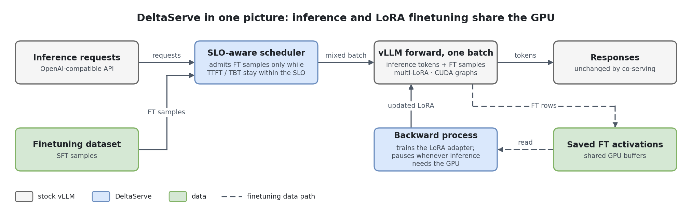
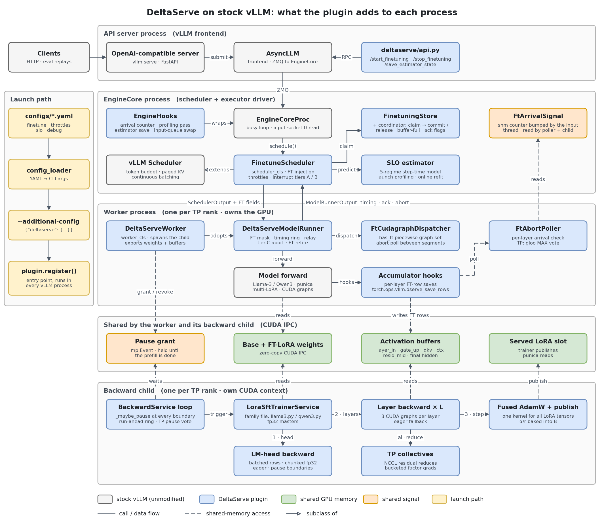
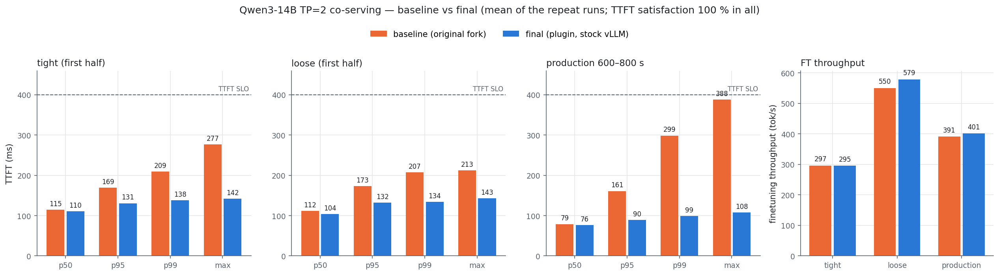
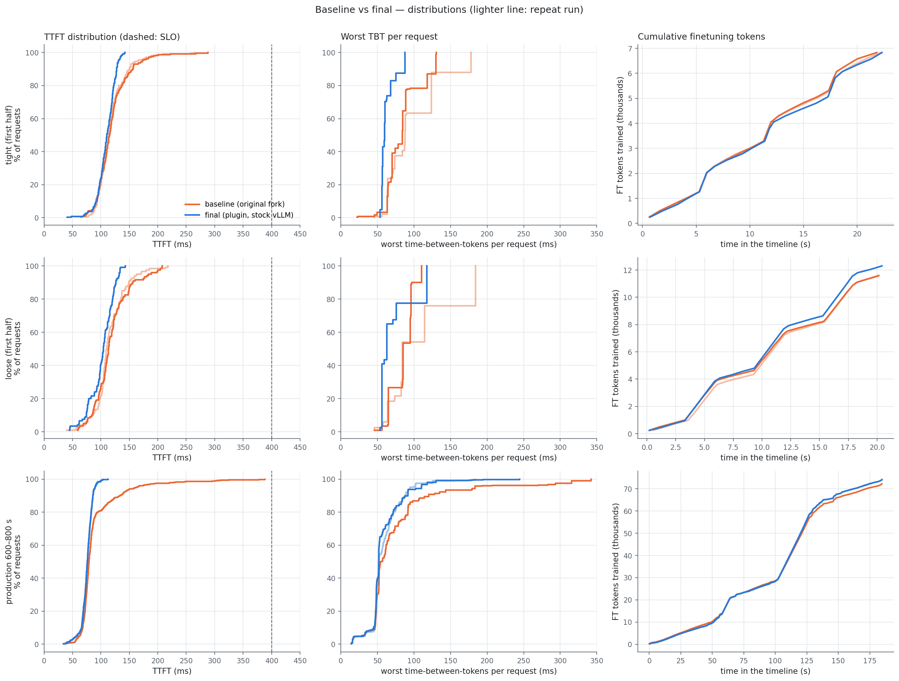

# DeltaServe-vLLM

**Co-serving LLM inference and LoRA finetuning on the same GPUs, as a plugin for
stock vLLM.**

DeltaServe runs a LoRA supervised-finetuning (SFT) job *inside* a live inference
server. Each step it slips finetuning (FT) samples into the inference batches and
records their activations during the forward pass. A backward process on the same
GPU then trains a dedicated LoRA adapter from those activations. An SLO-aware
scheduler decides, step by step, how much FT work to admit so that inference
time-to-first-token (TTFT) and time-between-tokens (TBT) stay within their SLOs.

This repo re-hosts DeltaServe's co-serving layer on vLLM's V1 engine. vLLM already
provides the inference side: multi-LoRA batching (punica kernels), paged KV,
continuous batching and the multi-process engine. DeltaServe adds what vLLM does
not have:

- **Activation capture:** FT rows are saved during the forward pass.
- **Backward process:** one per GPU, with a hand-written LoRA backward and CUDA graphs.
- **SLO-aware admission scheduler:** with a step-time estimator.
- **Pre-emption and pause machinery:** keeps inference latency protected.

All of it ships as a **vLLM general plugin** (`deltaserve`, in `deltaserve-plugin/`).
**vLLM itself is unmodified:** `vllm-upstream/` is a git submodule pinned at
the
[`v0.33.0`](https://github.com/vllm-project/vllm/releases/tag/v0.33.0) release
(`4ba787ec9`), with no patches. Co-serving is enabled per launch through
vLLM's own `--additional-config`. Without it, the server is plain vLLM.

> **Looking for the original code?** The pre-plugin version (a patched vLLM fork,
> `dserve-vllm/`), the original DeltaServe framework (`DeltaServe/`) and all the
> phase-by-phase design notes (`INTEGRATION_PROGRESS.md`, `VLLM_FORK_CHANGES.md`, …)
> are on the [`legacy`](https://github.com/852866031/DeltaServe-vLLM/tree/legacy)
> branch.

---

## Contents

1. [Get started](#get-started)
2. [How it works](#how-it-works)
3. [Supported models](#supported-models)
4. [Features](#features)
   - [Forward pass](#forward-pass)
   - [Backward pass](#backward-pass)
   - [CUDA graphs at a glance](#cuda-graphs-at-a-glance)
   - [Interrupts and pauses](#interrupts-and-pauses-protecting-inference-latency)
   - [Throttles and admission control](#throttles-and-admission-control)
   - [Optimizations](#optimizations)
5. [Results](#results)
6. [Repository layout](#repository-layout)
7. [Installation](#installation)
8. [Launching a server](#launching-a-server)
9. [Running experiments](#running-experiments)
10. [Tests](#tests)

---

## Get started

The shortest path from a fresh clone to a co-serving server on one GPU
(Qwen3-0.6B). Every step links to its full section below.

**1. Clone** with the pinned vLLM submodule:

```bash
git clone --recurse-submodules https://github.com/852866031/DeltaServe-vLLM.git
cd DeltaServe-vLLM
```

**2. Install** vLLM v0.33.0 (precompiled kernels, no CUDA build) and the plugin into
a fresh env. On an RTX 5090, use the [RTX 5090 steps](#rtx-5090-blackwell-sm_120)
instead (it needs CUDA 13 inside the env first).

```bash
conda create -n deltaserve python=3.12 -y && conda activate deltaserve
pip install uv
cd vllm-upstream
VLLM_VERSION_OVERRIDE=0.33.0 \
    VLLM_PRECOMPILED_WHEEL_COMMIT=4ba787ec9959e566d3b587a796dff07673324da5 \
    VLLM_USE_PRECOMPILED=1 \
    uv pip install --editable . --torch-backend=auto
cd ..
uv pip install --editable deltaserve-plugin --no-deps
pip install peft datasets pandas matplotlib
uv pip uninstall torchaudio     # vLLM 0.33 pins a torchaudio built for an older torch
```

**3. Download the model.** The launchers run with `HF_HUB_OFFLINE=1`, so fetch the
weights once:

```bash
export HF_HOME=$HOME/hf-cache
huggingface-cli download Qwen/Qwen3-0.6B-Base
```

**4. Build the LoRA adapters.** The repo ships only their configs; the weights
(an inference adapter and the `-ft` copy the backward trains) are built locally in a
few minutes:

```bash
python scripts/init_adapters_qwen3.py --size 0.6b
```

**5. Check the install** (CPU only, a few seconds), then **launch** a co-serving
server. `--start-finetuning` opens FT admission once the server is healthy:

```bash
python tests/test_phase1_step1.py
python eval-tp/launch_deltaserve.py --family qwen3-0.6b --start-finetuning --hf-home $HF_HOME
```

**6. Send a request** from another shell. The server log prints one
`[backward] … loss=…` line per training cycle while it serves:

```bash
curl -s localhost:8000/v1/completions -H 'content-type: application/json' \
     -d '{"model": "qwen3-0.6b-toy-lora", "prompt": "The capital of France is", "max_tokens": 16}'
```

**Next:** the Qwen3-14B TP=2 preset (`--family qwen3-14b`, two GPUs), the
[timeline benchmarks](#running-experiments) and the [tests](#tests).

---

## How it works



Inference requests and finetuning samples go through **one** scheduler, which
packs FT samples into inference batches only while the latency SLOs allow it. The
forward pass serves both. For FT samples it also saves their activations, from
which a separate backward process trains the LoRA adapter, yielding the GPU
whenever inference needs it. The trained adapter is published back into the
server.

**In detail** — what the plugin adds to each vLLM process:



<sub>Editable sources: [`docs/figures/overview.drawio`](docs/figures/overview.drawio),
[`docs/figures/architecture.drawio`](docs/figures/architecture.drawio)
(open in draw.io / diagrams.net). Regenerate the PNG/SVG with
`python docs/figures/make_overview.py` / `make_architecture.py`.</sub>

vLLM runs three kinds of processes. DeltaServe adds a fourth, the backward child.
The plugin's entry point, `deltaserve.plugin:register`, is declared under
`vllm.general_plugins`, so vLLM calls it in **every** process. It changes nothing
unless the launch carries `--additional-config '{"deltaserve": {...}}'`. When it
does, `register` wraps a handful of upstream methods and selects DeltaServe's own
worker and scheduler classes through vLLM's existing `worker_cls` / `scheduler_cls`
config fields.

| Process | Stock vLLM | What DeltaServe adds | Seam (how it plugs in, no vLLM edit) |
|---|---|---|---|
| **API server** | OpenAI server, `AsyncLLM` | `/start_finetuning`, `/stop_finetuning`, `/save_estimator_state` | wrapper on `register_vllm_serve_api_routers` |
| **EngineCore** | `EngineCoreProc`, `Scheduler` | `FinetuneScheduler`: FT injection, SLO admission, throttles, interrupt tiers A/B. `EngineHooks`: arrival counter, launch profiling pass, estimator save | `scheduler_cls`; wrappers on `EngineCore` / `EngineCoreProc` methods; input-queue class swap |
| **Worker** (per TP rank) | `Worker`, `GPUModelRunner`, model, CUDA graphs | `DeltaServeWorker` spawns the backward child and exports weights and buffers over CUDA IPC. `DeltaServeModelRunner` builds the FT mask, keeps the timing ring, handles tier-C abort and relays results to the scheduler. `FtCudagraphDispatcher` adds the `has_ft` graph set. Accumulator hooks save FT activations | `worker_cls`; the worker adopts the runner by class swap; a dispatcher subclass with its own batch-descriptor class; wrapper on `CUDAGraphWrapper.__call__`; a custom op traced by Dynamo |
| **Backward child** (per TP rank) | — | LoRA SFT trainer (`bwd_services/`): manual per-layer backward, CUDA graphs, fused AdamW, publish to the served LoRA slot | spawned by the worker (daemon check lifted around `start()`) |

**Life of one FT sample**

1. **Admission.** The scheduler asks the SLO estimator how many FT tokens fit in
   the next step. It then claims samples from the `FinetuningStore` and appends
   them to the batch as `max_tokens=1` prefill-only requests, routed to the FT
   LoRA adapter.
2. **Forward.** The runner marks FT rows with a `finetune_mask`. Per-layer
   accumulator hooks copy those rows into **shared activation buffers**:
   `layer_in`, `gate_up`, optionally `qkv` / `ctx` / `resid_mid`, final hidden
   states and targets. Inference rows in the same batch are untouched. The FT
   requests retire in the same step and never reach the frontend.
3. **Trigger.** When the buffer is full (or cannot fit the next sample, or an
   epoch ends), the trigger is relayed to every rank on `SchedulerOutput`, so
   all TP ranks fire on the same step.
4. **Backward.** The child runs the LoRA backward from the saved activations: LM
   head, then each layer in reverse, then fused AdamW. It writes the updated
   adapter into the **served LoRA slot**, so inference uses the new weights
   immediately. Throughout, it yields the GPU to inference at every layer
   boundary (`_maybe_pause`).
5. **Ack.** Each rank's child reports done. The ack reaches the scheduler only
   when every rank has finished, and then admission reopens.

Without `--additional-config`, the backward child is never spawned and every
hook is inert.

---

## Supported models

| Family | HF architecture | Backward service | Tested on | Notes |
|---|---|---|---|---|
| **Qwen3** | `Qwen3ForCausalLM` | `bwd_services/qwen3.py` | **Qwen3-14B-Base, TP=2** (2× RTX 5090): primary target, full stack. Qwen3-0.6B-Base, TP=1 (smoke). Qwen3-14B / 32B at TP=4 on A100 (configs in `configs/*_A100*.yaml`) | Per-head `q_norm` / `k_norm` handled in the backward. Mixed-batch forward CUDA graphs supported. Tied `lm_head` (0.6B) resolved through the LoRA-wrapped embedding |
| **Llama-3** | `LlamaForCausalLM` | `bwd_services/llama3.py` | Meta-Llama-3-8B, TP=1 and TP=2 | Full backward stack. Mixed-batch forward graphs not wired (FT batches run eager) |

**Adding a family.** Write `bwd_services/<family>.py` (its layer forward and
backward plus a `Family` record; everything shared lives in `bwd_services/common/`),
register it in `bwd_services/registry.py`, and add a YAML. vLLM needs no change
unless the architecture breaks a generic assumption: module names, SwiGLU or
RMSNorm.

**LoRA targets:** `q_proj`, `k_proj`, `v_proj`, `o_proj` (rank 16 in the shipped
toy adapters). **Parallelism:** tensor parallel. Each rank trains its own weight
shard in its own child, joined by a dedicated NCCL group. Pipeline parallelism
has not been tested.

---

## Features

### Forward pass

Every step is one vLLM batch. What runs depends on what the batch contains:

| Batch type | Contains | How it runs | CUDA graph | Activation save |
|---|---|---|---|---|
| **Inference-only** | prefill and/or decode | stock vLLM | ✅ stock: piecewise, plus FULL for uniform decode | — |
| **Mixed** | inference + FT samples | compiled forward | ✅ **`has_ft` piecewise set** (`graph_ft_batches`, Qwen3), up to `graph_ft_max_tokens` (512) padded tokens; larger batches run compiled without a graph. Never FULL | `torch.ops.vllm.dserve_save_rows`, a capturable op fed by persistent index tensors |
| **Mixed** (graphs off / Llama-3) | inference + FT | eager | ❌ | Python forward hooks (slice fast path) |
| **FT-only** | only FT samples (idle GPU) | compiled + graphs with `graph_ft_only_batches`, else eager | ✅ same `has_ft` set (opt-in) / ❌ | same as above |

- FT samples are **prefill-only**. They run once, hold no KV past the step, emit no
  tokens, and are invisible to clients.
- Only hidden states are saved (no logits). The backward child computes the
  LM head itself.
- The `has_ft` graphs are their own capture set (keyed by `FtBatchDescriptor`), so
  inference-only steps keep replaying vLLM's unmodified graphs. The graph-affecting
  FT flags feed vLLM's compile-cache hash, so toggling one recompiles instead of
  loading a stale graph.

### Backward pass

The trainer is a hand-written LoRA SFT backward (no autograd), gradchecked against
autograd to ~1e-7. It rematerializes each layer from the saved activations,
backpropagates, and steps an fp32 master copy of the LoRA weights.

| Stage | What it does | CUDA graph? | Precision |
|---|---|---|---|
| **LM head backward** | final RMSNorm + vocab projection + cross-entropy, batched over all predicting rows | ❌ eager: chunked over the vocab, each chunk is a pause boundary | **fp32** (logits, softmax, norm) |
| **Layer forward recompute** | RMSNorm → (Q/K/V proj + RoPE) → attention → O proj → residual, skipping whatever was saved | ✅ **Graph 1**, one per layer | bf16 GEMMs, fp32 scores/softmax |
| **FFN backward** | SwiGLU MLP backward (frozen), post-attention RMSNorm backward | ✅ **Graph 2**, one per layer | bf16 GEMMs, fp32 norm |
| **Attention backward** | padded multi-sample GQA attention backward + Q/K/V/O LoRA grads | ✅ **Graph 3**, one shared graph reused by every layer | **fp32 scores** |
| **TP collectives** | 2 residual all-reduces per layer; LoRA factor grads bucketed every 8 layers on a comm stream; 1 tiny `[L]` reduce for the clip | ❌ always eager, between replays | — |
| **Optimizer** | per-layer grad clip (rank-symmetric under TP), **fused AdamW** (one kernel for all LoRA tensors), StepLR | ❌ eager | fp32 masters |
| **Publish** | write the trained adapter into vLLM's served LoRA slot, with `α/r` baked into B | ❌ | bf16 |

`_maybe_pause` is called **between** the graphs of every layer and inside the LM
head's chunk loop. It cannot sit inside a captured region, which is why the
backward is three graphs per layer rather than one graph per step.

### CUDA graphs at a glance

| Graph | Where | Type | Captures | Not captured | Flag (default) |
|---|---|---|---|---|---|
| Inference graphs | worker | vLLM piecewise + FULL | the whole forward, split at attention | — | stock vLLM |
| **`has_ft` forward set** | worker | **piecewise** (one segment per layer), captured at startup next to vLLM's | mixed (and opt-in FT-only) forward + the FT row saves | attention (piecewise split); the tier-C abort poll runs **between** segments | `graph_ft_batches` (off; on in Qwen3 YAMLs), `graph_ft_only_batches` (off; on in the Qwen3-14B TP=2 preset), `graph_ft_max_tokens: 512` |
| **Backward Graph 1**: forward recompute | backward child | full-region graph, **per layer** | in-norm, (Q/K/V + RoPE), padded attention fwd, O proj, residual: only the parts not saved | the O-proj all-reduce under TP (graph split at `static_o`) | `backward_cuda_graph` (off; on in TP YAMLs) |
| **Backward Graph 2**: FFN bwd | backward child | full-region graph, **per layer** | SwiGLU + RMSNorm backward | residual all-reduce | same |
| **Backward Graph 3**: attention bwd | backward child | full-region graph, **one, shared** across layers (no per-layer weights in the core) | padded GQA attention backward | residual all-reduce | same; fits ≤ `backward_cuda_graph_attn_bn_max` (8) samples × ≤ `…_l_max` (64) tokens, otherwise eager for that cycle |
| — | backward child | — | — | LM head, AdamW, all collectives, `_maybe_pause` | — |

Every backward graph falls back to eager per layer on a capture or shape-fit
failure, with identical gradients.

### Interrupts and pauses (protecting inference latency)

Two directions of contention, two sets of mechanisms:

**1. An inference request arrives while an FT-only forward is about to run or is
running. That forward is pre-empted.** Enabled by `finetune.forward_interruptible`.

| Tier | When | What happens | TP |
|---|---|---|---|
| **A**: grace poll | before `schedule()` would produce an FT-only step | engine blocks up to `ft_only_admission_grace_ms` (2 ms) on the input queue; an arrival schedules inference instead | n/a (scheduler) |
| **B**: rollback | arrival lands between `schedule()` and `execute_model()` | FT scheduling rolled back (KV, claimed samples, buffer reservation released) and the step re-scheduled once | n/a |
| **C**: mid-forward abort | arrival lands **during** the FT-only forward | eager: per-layer hook raises `FTAborted`; graphed: the poll between piecewise segments aborts. Partial writes zeroed, samples released, step treated as empty | **rank-symmetric**: shm arrival counter + gloo MAX vote per layer, so all ranks leave at the same layer |

A co-serving batch that carries inference tokens is **never** aborted.

**2. The backward child is running while inference needs the GPU. The child pauses.**
The child checks a grant (`mp.Event`) at every boundary, about half a layer apart.

| Mechanism | Pauses the child when… | Resumes when… | Flag (default) |
|---|---|---|---|
| Prefill pause | a step carries inference prefill | that step finishes | always on |
| `pause_until_prefill_done` | (refines the above) | the prefill has **completed on the GPU** (CUDA event), not merely been enqueued | `true` |
| `pause_on_arrival` | a request **arrives** (shm counter), before its prefill is even scheduled | that request's prefill pause ends, or after 100 ms | `false` (on in Qwen3-14B TP=2 preset) |
| `pause_prefill_always` | every prefill step, even with no backward outstanding (closes the TP trigger race) | step done | `false` |
| `fwd_token_throttle` | the batch's total tokens ≥ threshold | it drops below | `throttles.fwd_token_throttle_enable` (`false`) |
| Run-ahead bound | — | — | `backward_run_ahead_boundaries: 2`: the child's CPU stays ≤ 2 boundaries ahead of its GPU, so a pause takes effect within ~3–6 ms |
| TP agreement | — | — | all children vote over gloo at each boundary and pause at the **same** one (otherwise a peer's in-flight NCCL kernel would spin on the GPU) |

A race fix is always on: if a backward trigger arrives while a prefill is in flight,
the child starts in the paused state.

### Throttles and admission control

FT admission is decided per step in `FinetuneScheduler`. The **SLO gate** always
applies. The throttles shape admission further:

| Knob (YAML section) | What it controls | Default |
|---|---|---|
| **SLO gate** (`slo.ttft_slo`, `max_tbt_slo`, `avg_tbt_slo`) | admit FT tokens only while the estimator predicts the step stays within 0.9 × TTFT SLO for the oldest waiting request and within `max_tbt_slo` | always on |
| **Step-time estimator** (`slo.profile_on_launch`, `profile_num_repeats`) | 6-parameter model `T ≈ α·S + β·T_in + γ·T_ft + δ·B_d + ε·K + c`, with separate coefficients for 5 regimes (inference prefill, FT-only, decode-only, decode with backward running, FT-mixed). Seeded by a profiling pass at launch, refit online every 256 steps | profiling on |
| `slo.coserving_admission_phase` | `prefill`: FT rides only steps that carry inference prefill (or idle steps). `both`: FT may also ride decode-only / mixed steps (`BothPhaseFinetuneScheduler`) | `prefill` |
| `slo.decode_only_ft_safety_margin` | with `both`: scale `max_tbt_slo` on decode-only steps | `0.7` |
| `throttles.ft_tokens_admission_constrain_factor` | cap FT tokens at `factor × inference-prefill tokens` per step (`-1` = off) | `-1` |
| `throttles.match_prefill_workload_factor` | leaky bucket: admit one FT sample once accumulated prefill × factor covers its length (`0` = off) | `0` |
| `throttles.fwd_token_throttle_enable` / `fwd_token_throttle` | pause the backward when the batch's total tokens ≥ threshold | off / 1024 |
| `throttles.rps_throttle_*` | close FT admission above `close_rps`, reopen below `open_rps` (hysteresis, sliding window, minimum close time) | off |
| `finetune.start_on_launch` | open admission at launch, or wait for `POST /start_finetuning` | `true` (`false` in the shipped YAMLs) |
| Buffer accounting | FT budget ≤ free activation-buffer space; flush when the next-smallest sample won't fit | always |

### Optimizations

| Optimization | Effect | Flag |
|---|---|---|
| Mixed-batch forward CUDA graphs | mixed-step FT cost 14 → 4–8 ms; FT +8–39 % at the same TTFT | `graph_ft_batches` |
| FT-only forward CUDA graphs (abortable) | removes ~63 ms of host dispatch per FT-only step on Qwen3-14B TP=2; production FT +5 % | `graph_ft_only_batches` |
| Backward CUDA graphs (3 per layer) | ~5 ms less dispatch per cycle | `backward_cuda_graph` |
| Save MLP gate/up pre-activation | skips the gate_up GEMM recompute | `save_activations` (on) |
| Save q/k/v | skips Q/K/V projection (+ RoPE on Llama-3), ~400–500 GFLOPs per backward on Llama-3-8B | `save_attn_qkv` |
| Save attention context | skips the attention forward recompute | `save_attn_ctx` |
| Save post-attention residual | skips the O-proj GEMM; **under TP removes the forward recompute's only all-reduce** (7 → 6 per layer) | `save_resid_mid` |
| *(all three saves on)* | per-layer forward recompute = one RMSNorm | — |
| Batched fp32 LM head | one GEMM over all rows, one bf16→fp32 conversion per chunk: cycle 168 → 127 ms (Qwen3-14B) | always |
| Bucketed TP gradient reduce + comm stream | 240 → 86 collectives per cycle, overlapped with compute | always under TP |
| Fused AdamW + persistent grad buffers | one optimizer kernel; no per-cycle zero-fills | always |
| Slice-based activation save | `val[start:start+n]` view instead of `index_select` when FT rows are contiguous | always (falls back to a mask gather) |
| `disable_log_stats` auto-on | removes a frontend stall (per-step stats saturating the API asyncio loop) that looked like GPU contention | automatic with finetuning |
| Precision contract | fp32 attention scores/softmax, RMSNorm, LM head, LoRA masters; bf16 bulk GEMMs | `backward_fp32: false` (true = all-fp32 GEMMs) |

---

## Results

Qwen3-14B-Base, TP=2 on 2× RTX 5090, co-serving the shipped preset
(`configs/serving_config_finetuning_qwen3_14b_tp2.yaml`), TTFT SLO 0.4 s. Three
inference workloads replayed from recorded traces:

| Workload | Requests | Span | Rate |
|---|---|---|---|
| tight-half | 240 | 22 s | ~11 req/s |
| loose-half | 120 | 20 s | ~6 req/s |
| production-600-800 | 534 | 184 s | ~2.9 req/s (production trace slice) |

The baseline is the original patched-fork implementation. The final version is
this plugin on stock vLLM. Each figure is the mean of two runs.

| Workload | TTFT p99, baseline → final | FT throughput, baseline → final | TTFT SLO satisfaction |
|---|---|---|---|
| tight-half | 201 → **137 ms** | 297 → 295 tok/s | 100 % → 100 % |
| loose-half | 204 → **134 ms** | 550 → **579** tok/s | 100 % → 100 % |
| production-600-800 | 295 → **~100 ms** | 391 → **401** tok/s | 100 % → 100 % |




Reproduce with `eval-tp/cleanup_validate.sh` (see [Running experiments](#running-experiments)).

**vLLM v0.33.0 (current pin) vs the previous pin (117afeea4)**, same plugin and preset:

| Workload | TTFT p50 | TTFT p99 | FT throughput | TTFT SLO satisfaction |
|---|---|---|---|---|
| tight-half | 110.5 → **102.9 ms** | 138 → 143 ms | 295 → **360 tok/s (+22 %)** | 100 % → 100 % |
| loose-half | 104.2 → **87.8 ms** | 134 → 135 ms | 579 → **626 tok/s (+8 %)** | 100 % → 100 % |
| production-600-800 | 76.1 → **68.9 ms** | 99.8 → **89.3 ms** | 401 → **460 tok/s (+15 %)** | 100 % → 100 % |

vLLM itself got faster (decode step 18.3 → 14.9 ms, prefill 40 → 36 ms) and its CUDA
graphs use 6.8 → 4.0 GiB, leaving ~15 % more KV cache. One regression, upstream and not
FT-specific: the host dispatch of piecewise prefill steps grew 2 → ~20 ms (inference-only
prefills too); async scheduling hides it.

---

## Repository layout

```
DeltaServe-vLLM/
├── deltaserve-plugin/                 the plugin (pip name "deltaserve")
│   ├── pyproject.toml                 entry point: vllm.general_plugins → deltaserve.plugin:register
│   └── deltaserve/
│       ├── plugin.py                  register(): every wrapper / class selection (start here)
│       ├── config.py                  FinetuneConfig: every flag, documented
│       ├── config_loader.py           YAML → vLLM CLI args (+ --additional-config)
│       ├── engine_config.py           worker_cls / scheduler_cls / async defaults
│       ├── engine_core.py             EngineHooks: arrival signal, profiling, input queue
│       ├── ft_scheduler.py            FinetuneScheduler: injection, SLO admission, tiers A/B
│       ├── ft_scheduler_both.py       BothPhaseFinetuneScheduler (admission phase "both")
│       ├── estimator.py               step-time estimator + tracker
│       ├── profiling_batch_generator.py  launch-time profiling shapes
│       ├── finetuning_store.py        sample store (claim / commit / release)
│       ├── ft_injector.py             builds the FT requests
│       ├── coordinator.py             buffer flags, relay, FtArrivalSignal, FtAbortPoller
│       ├── worker.py                  DeltaServeWorker: child spawn, CUDA-IPC export
│       ├── model_runner.py            DeltaServeModelRunner: mask, timing, tier C, relay
│       ├── cudagraph.py               FtCudagraphDispatcher + FtBatchDescriptor
│       ├── accumulate.py              per-layer activation-save hooks
│       ├── ft_save_op.py              torch.ops.vllm.dserve_save_rows
│       ├── backward_process.py        child process launch / IPC
│       ├── bwd_services/              backward trainers
│       │   ├── base.py                recv loop, _maybe_pause
│       │   ├── registry.py            HF arch → service
│       │   ├── common/                ops, attention, ffn, head, tp, trainer, graph
│       │   ├── llama3.py              Llama-3 family
│       │   └── qwen3.py               Qwen3 family
│       └── api.py                     HTTP routes
├── vllm-upstream/                     stock vLLM v0.33.0 (git submodule, no patches)
├── configs/                           serving YAMLs (5090 + A100 presets)
├── adapters/                          toy LoRA adapters (inference + "-ft" training target)
├── data/                              datasets: FT corpora (alpaca_1000.txt, test_dataset.txt),
│                                      request traces (timelines/5090, timelines/A100)
├── eval-tp/                           main eval: launcher, timeline replay, A/B compare, plots
├── eval/                              single-GPU eval, pure-FT bench, plotting
├── eval-arxiv/                        long-context probe (16k, arxiv summarization)
├── scripts/                           adapter builders, config converter, timeline generators (timelines/)
├── tests/                             standalone test scripts (+ run_all.sh)
└── docs/figures/                      overview + architecture figures (+ generators), result plots
```

---

## Installation

> **RTX 5090 (Blackwell, sm_120)?** Use the
> [RTX 5090 section](#rtx-5090-blackwell-sm_120). Blackwell needs CUDA ≥ 12.9
> inside the env and a one-time FlashInfer JIT that other GPUs do not.

### General (A100 / H100 / L40 / 4090: Ampere, Ada, Hopper)

Prerequisites: a CUDA 12.x-capable NVIDIA driver (`nvidia-smi`), `conda`, `git`.

```bash
# 1. Clone with stock vLLM at the pinned commit (the vllm-upstream submodule)
git clone --recurse-submodules https://github.com/852866031/DeltaServe-vLLM.git
cd DeltaServe-vLLM
# (cloned without it? run: git submodule update --init vllm-upstream)

# 2. Fresh env
conda create -n deltaserve python=3.12 -y
conda activate deltaserve
pip install uv            # for --torch-backend=auto

# 3. Stock vLLM, editable, with its precompiled kernels (no CUDA build).
#    VLLM_PRECOMPILED_WHEEL_COMMIT pins the .so files to the submodule commit.
cd vllm-upstream
VLLM_VERSION_OVERRIDE=0.33.0 \
    VLLM_PRECOMPILED_WHEEL_COMMIT=4ba787ec9959e566d3b587a796dff07673324da5 \
    VLLM_USE_PRECOMPILED=1 \
    uv pip install --editable . --torch-backend=auto
cd ..

# 4. The plugin (pure Python; vLLM discovers it through its entry point)
uv pip install --editable deltaserve-plugin --no-deps

# vLLM 0.33 pins torchaudio 2.11 next to torch 2.14; transformers imports it and
# its CUDA-version check fails. Text-only serving does not need it:
uv pip uninstall torchaudio

# 5. Eval / adapter-building extras
pip install peft datasets pandas matplotlib
```

> **Without `uv`:** install torch from the matching index first (`cu128` for CUDA
> 12.x, `cu130` for 13.x), then use `pip install --editable .` in step 3 and
> `pip install --editable deltaserve-plugin --no-deps` in step 4.

Sanity check (no GPU work):

```bash
python -c "import importlib.metadata as m; print([e.value for e in m.entry_points(group='vllm.general_plugins')])"
# expect: ['deltaserve.plugin:register']
python tests/test_phase1_step1.py     # plugin wiring, CPU only
python -c "from vllm import LLM; print(LLM('facebook/opt-125m').generate('Hello'))"   # GPU smoke
```

### RTX 5090 (Blackwell, sm_120)

vLLM's precompiled kernels cover sm_120, but FlashInfer does three things that
need handling:

1. It requires `nvcc` ≥ 12.9 for sm_120. It picks the first `nvcc` on `PATH`; a
   system CUDA 12.8 makes it fail with a misleading *"requires sm75 or higher"*.
2. Its JIT linker needs `libcuda.so`, from the CUDA stubs dir.
3. It has no prebuilt sm_120 cubins, so it JIT-compiles on first use (one time).

The fix is to make the conda env own CUDA 13.0:

```bash
git clone --recurse-submodules https://github.com/852866031/DeltaServe-vLLM.git
cd DeltaServe-vLLM
conda create -n deltaserve python=3.12 -y
conda activate deltaserve

# CUDA 13.0 toolkit inside the env (provides nvcc 13.0)
conda install -c nvidia cuda-toolkit=13.0 -y

# Every new shell (or persist with `conda env config vars set ...`):
export CUDA_HOME=$CONDA_PREFIX
export PATH=$CONDA_PREFIX/bin:$PATH
export LIBRARY_PATH=$CONDA_PREFIX/lib/stubs${LIBRARY_PATH:+:$LIBRARY_PATH}
hash -r
which nvcc && nvcc --version     # MUST be $CONDA_PREFIX/bin/nvcc, release 13.0

# vLLM (precompiled, pulls torch cu130) + the plugin
pip install uv
cd vllm-upstream
VLLM_VERSION_OVERRIDE=0.33.0 \
    VLLM_PRECOMPILED_WHEEL_COMMIT=4ba787ec9959e566d3b587a796dff07673324da5 \
    VLLM_USE_PRECOMPILED=1 \
    uv pip install --editable . --torch-backend=auto
cd ..
uv pip install --editable deltaserve-plugin --no-deps
pip install peft datasets pandas matplotlib
uv pip uninstall torchaudio     # vLLM 0.33 pins torchaudio 2.11 next to torch 2.14

# Check, then trigger the one-time FlashInfer JIT
python -c "import torch; print(torch.__version__, torch.version.cuda, torch.cuda.get_device_capability())"
# expect: 2.14.0+cu132 13.2 (12, 0)
python -c "from vllm import LLM; print(LLM('facebook/opt-125m').generate('Hello'))"
```

| Symptom | Cause | Fix |
|---|---|---|
| `FlashInfer requires GPUs with sm75 or higher` / `SM 12.x requires CUDA >= 12.9` | a system `nvcc` < 12.9 shadows the env's | the `export PATH… ; hash -r` lines; recheck `nvcc --version` |
| `cannot find -lcuda` during JIT | linker can't find `libcuda.so` | `LIBRARY_PATH=$CONDA_PREFIX/lib/stubs` |
| `sm_120 is not compatible with the current PyTorch` | torch is not cu128+/cu130 | reinstall torch from a cu130 index |
| `no kernel image is available` from a vLLM `_C` op | vLLM's own kernels lack sm_120 (not expected with current wheels) | full source build with `TORCH_CUDA_ARCH_LIST=12.0` |
| out-of-memory minutes into a run | a previous run left GPU processes | `--kill-stale` on the launchers, or `nvidia-smi` and kill them |

**No P2P on consumer cards.** Two 5090s have no NVLink or P2P, so vLLM's custom
all-reduce is disabled and every collective goes through host memory. This is
the TP floor on that hardware. No MPS daemon is assumed
(`backward_mps_percentage: 0`); latency protection comes from the pause contract.

### Models and adapters

Set `HF_HOME` to your weight cache. The launchers set `HF_HUB_OFFLINE=1` unless you
set it yourself, so download each base model once first
(`huggingface-cli download Qwen/Qwen3-14B-Base`), and pass `--hf-home` (the
launcher's built-in default is this project's own machine).

Every serving YAML needs two adapter directories: an **inference** adapter, served
by name, and an **`-ft`** copy that the backward trains. `adapters/` holds only
their configs; the weights (`adapter_model.safetensors`) are not in the repo, so
build them once (a few minutes; the 14B one uses both GPUs). A launch whose FT
adapter has no weights stops at startup with an error saying so.

```bash
python scripts/init_adapters_qwen3.py              # adapters/qwen3-14b-toy-lora{,-ft}  (Qwen/Qwen3-14B-Base)
python scripts/init_adapters_qwen3.py --size 0.6b  # adapters/qwen3-0.6b-toy-lora{,-ft}
python scripts/init_adapters_llama3.py             # adapters/llama3-toy-lora{,-ft}     (meta-llama/Meta-Llama-3-8B, gated)
```

---

## Launching a server

### The serving YAML

Launchers turn one YAML (`configs/`) into a `vllm serve` command. The co-serving
sections go into `--additional-config`. The rest become ordinary vLLM flags.

| Section | Holds |
|---|---|
| `finetune` | the FT job (corpus `data_path`, FT adapter, epochs, lr, buffer size `max_saved_finetuning_tokens`), forward/backward graph flags, activation saves, interrupts, pauses |
| `throttles` | admission shapers ([table above](#throttles-and-admission-control)) |
| `slo` | `ttft_slo`, `avg_tbt_slo`, `max_tbt_slo`, estimator profiling, admission phase |
| `debug` | log switches (`print_scheduler_add`, `print_engine_batch_exec`, …) and trace paths |
| `model`, `engine`, `parallel`, `lora`, `adapters`, `server` | plain vLLM settings: base model, memory, TP size, LoRA limits, inference adapter, port |

`finetune.*` fields are documented one by one in
[`deltaserve-plugin/deltaserve/config.py`](deltaserve-plugin/deltaserve/config.py).
Relative paths resolve against the YAML's directory. Old flat-layout YAMLs still
load (with a warning); `scripts/convert_config_layout.py` rewrites them.

**Presets:**

| YAML | Model | GPUs |
|---|---|---|
| `serving_config_finetuning_qwen3_14b_tp2.yaml` | Qwen3-14B-Base | 2× 5090, TP=2 (**main preset**) |
| `serving_config_finetuning_qwen3_0.6b.yaml` | Qwen3-0.6B-Base | 1 GPU |
| `serving_config_finetuning_llama3{,_tp2}.yaml` | Meta-Llama-3-8B | 1 / 2 GPUs |
| `serving_config_finetuning_llama3_both.yaml` | Meta-Llama-3-8B | admission phase `both` |
| `*_A100*.yaml` | Qwen3-14B / 32B (TP=4), Llama-3-8B | A100 (contain absolute paths of the A100 box; adjust `data_path` / adapters) |
| `serving_config_finetuning_qwen3_14b_tp2_arxiv.yaml` | Qwen3-14B, 16k context | 2× 5090 (`eval-arxiv/`) |

### Launch

```bash
export HF_HOME=/path/to/hf-cache HF_HUB_OFFLINE=1

python eval-tp/launch_deltaserve.py --family qwen3-14b                     # Qwen3-14B TP=2 preset
python eval-tp/launch_deltaserve.py --family qwen3-14b --start-finetuning  # …and open FT admission once healthy
python eval-tp/launch_deltaserve.py --family qwen3-0.6b                    # single-GPU smoke
python eval-tp/launch_deltaserve.py --config configs/<any>.yaml --tp 2     # any YAML
python eval-tp/launch_deltaserve.py --family qwen3-14b --dry-run           # print the vllm serve command only
```

`--dry-run` shows the exact command. You can also write it by hand; it is plain
`vllm serve` with one extra argument:

```bash
vllm serve Qwen/Qwen3-14B-Base --tensor-parallel-size 2 \
    --enable-lora --max-loras 2 --max-lora-rank 16 \
    --lora-modules qwen3-14b-toy-lora=adapters/qwen3-14b-toy-lora \
    --additional-config '{"deltaserve": {"enable_finetuning": true,
        "finetuning_lora_path": "adapters/qwen3-14b-toy-lora-ft",
        "data_path": "data/alpaca_1000.txt", "start_on_launch": false,
        "ttft_slo": 0.4, "max_tbt_slo": 0.05, "backward_cuda_graph": true}}'
```

### HTTP endpoints

The OpenAI API is unchanged. Inference requests target the inference adapter by
its LoRA name. DeltaServe adds:

```bash
curl -X POST localhost:8000/start_finetuning        # open FT admission (start_on_launch: false)
curl -X POST localhost:8000/stop_finetuning         # close it
curl -X POST localhost:8000/save_estimator_state -H 'content-type: application/json' \
     -d '{"path": "estimator.json"}'                # dump the fitted estimator
```

Per-cycle training progress goes to the server log (`[backward] <ms>ms (graph)
loss=… n=… epoch=…`) and, if `bwd_log_path` is set, to a CSV.

---

## Running experiments

All eval scripts launch their own server, replay a workload, shut down, and write
CSVs. Keep `HF_HOME` / `HF_HUB_OFFLINE` set.

### Timeline replay (the main benchmark)

`eval-tp/auto_benchmark_tp.py` replays a recorded arrival trace
(`data/timelines/5090/`) as streaming `/v1/completions` calls. It records per-request
TTFT, latency and avg/worst TBT. With `--co` it also triggers finetuning after
warmup and logs every backward cycle.

```bash
# co-serving
python eval-tp/auto_benchmark_tp.py --family qwen3-14b --tp 2 --co --tight-half --kill-stale
python eval-tp/auto_benchmark_tp.py --family qwen3-14b --tp 2 --co --loose-half
python eval-tp/auto_benchmark_tp.py --family qwen3-14b --tp 2 --co --production-600-800

# inference-only baseline on the same trace (drop --co)
python eval-tp/auto_benchmark_tp.py --family qwen3-14b --tp 2 --tight-half
```

| Flag | Meaning |
|---|---|
| `--tight` / `--loose` / `--tight-half` / `--loose-half` / `--production` / `--production-600-800` | which trace (`--timeline_csv` for any CSV) |
| `--co` | co-serving; without it, the inference-only baseline |
| `--config` / `--model` / `--tp` | override the family preset |
| `--step-trace` | per-step predicted-vs-actual estimator trace (`eval-tp/analyze_step_trace.py`) |
| `--out-dir DIR` | one directory per run (default `eval-tp/output/`) |
| `--kill-stale` | kill GPU processes left by a crashed run instead of refusing to start |
| `--publish` | drop the factor/phase tags from file names |

Outputs: `timeline_results_<family>_tp<N>[_co_factor_<f>_phase_<p>]_<mode>.csv`
(per request), `bwd_log…csv` (per backward cycle), `bench_meta…json`, `server…log`.
Plot one run with
`python eval-tp/auto_plot_tp.py --family qwen3-14b --tp 2 --mode tight-half`.

### A/B validation against a saved run

```bash
eval-tp/cleanup_validate.sh 00_base tight-half loose-half production-600-800              # reference run
eval-tp/cleanup_validate.sh my_change tight-half loose-half                             # candidate, compared to 00_base
BASE=00_base CONFIG=configs/my_variant.yaml eval-tp/cleanup_validate.sh my_variant      # A/B a YAML variant
CO=0 eval-tp/cleanup_validate.sh inf_only tight-half                                    # inference-only

python eval-tp/compare_runs.py --suffix _qwen3-14b_tp2_co_factor_off_phase_prefill_tight-half \
    --a eval-tp/output/cleanup/00_base --b eval-tp/output/cleanup/my_change
python eval-tp/plot_cleanup_compare.py --base 00_base --final my_change
```

Each run goes to `eval-tp/output/cleanup/<tag>/`. `compare_runs.py` prints TTFT
percentiles and SLO satisfaction, worst-TBT, in-window FT throughput, backward
cycle times and estimator error, side by side. `plot_cleanup_compare.py` draws
the two figures shown in [Results](#results).

### Other benchmarks

```bash
python eval-tp/ft_bench_tp.py --family qwen3-14b --tp 2 --duration 120 --rps 4   # FT under constant-rate inference
python eval/pure_ft_bench.py --duration 100                                      # pure FT throughput, no inference
python eval/auto_benchmark.py --co --loose                                       # single-GPU Llama-3 timeline replay
python eval/auto_plot.py                                                         # its 4-panel figure
```

`eval-arxiv/` holds a long-context probe (16k-token arxiv summarization prompts on
Qwen3-14B TP=2). Its README has the numbers.

---

## Tests

Tests are standalone scripts; run them with `python`, not pytest.

```bash
tests/run_all.sh /tmp/ds-tests                 # everything; summary in /tmp/ds-tests/summary.txt
tests/run_all.sh /tmp/ds-tests 'test_qwen3_*'  # a subset
```

| Group | Scripts | Needs |
|---|---|---|
| Plugin wiring, config, store, estimator, child spawn | `test_phase1_step1`, `test_phase1_step2`, `test_config_loader`, `test_finetuning_store`, `test_merged_estimator`, `test_profiling_shapes`, `test_step_trace` | CPU |
| Activation hooks | `test_accumulate_hooks` | CPU |
| Graph-capturable save op, CUDA-IPC weight sharing | `test_ft_save_op`, `test_phase1_step3` | 1 GPU |
| Backward math (gradcheck vs autograd), graph == eager | `test_{llama3,qwen3}_backward`, `test_{llama3,qwen3}_backward_graph`, `test_{llama3,qwen3}_train_overfit` | 1 GPU |
| TP sharding and gradients | `test_{llama3,qwen3}_tp_shard`, `test_{llama3,qwen3}_tp_backward_gloo`, `test_tp_bucket_gloo`, `test_tp_timing_relay`, `test_ft_abort_tp` | CPU (gloo) |
| TP on real NCCL | `test_tp_backward_graph_nccl`, `test_tp_trainer_graph_nccl` | 2 GPUs |
| **Inference is unperturbed by co-serving** (amplified FT adapter + positive control; FT provably co-batched with real prefills and decodes; eager + CUDA graphs) | `test_phase1_m1` (Qwen3-0.6B), `test_tp_inference_leak` (Qwen3-14B TP=2, production preset) | 1 GPU / 2 GPUs + weights |
| End-to-end engine / server | `test_phase1_m2`, `test_pause_on_arrival`, `test_tp_no_orphans` | GPU(s) + model weights |

**Moving to a newer vLLM:** check out the new commit in `vllm-upstream`, reinstall
with its SHA, and run `tests/run_all.sh`. The plugin depends only on the vLLM APIs
it imports and the methods `deltaserve/plugin.py` wraps (listed in that file's
docstring).
