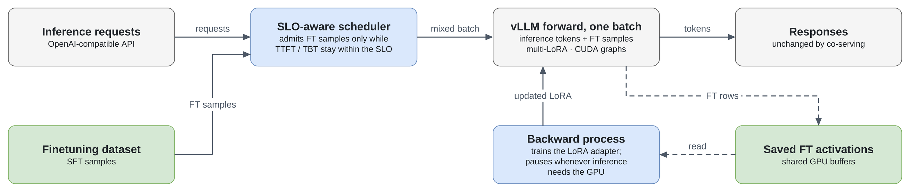
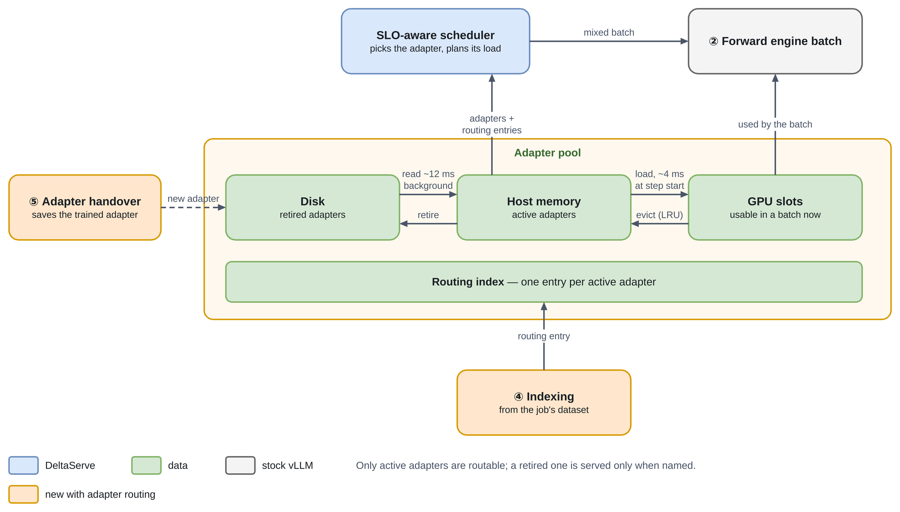
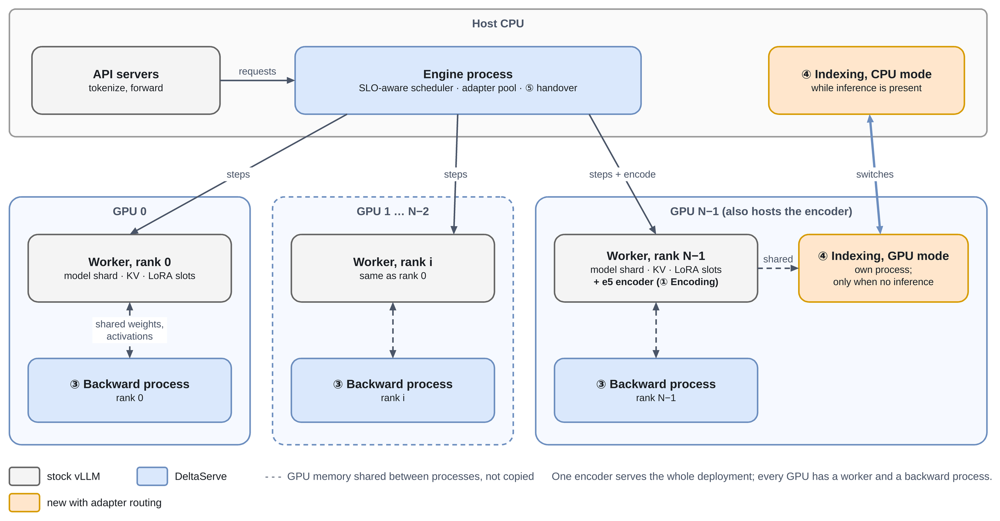
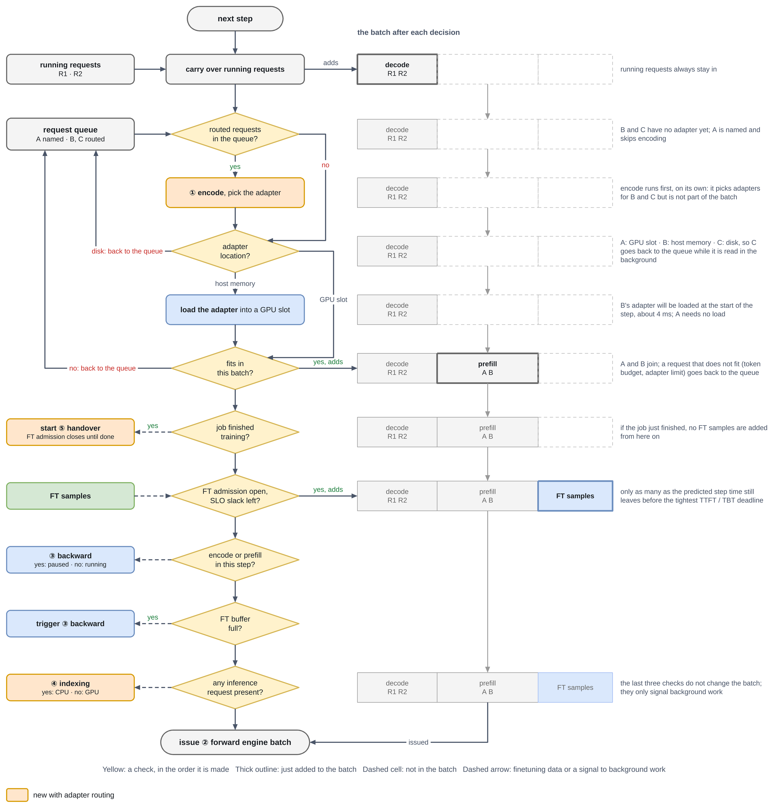

# Adapter routing under one scheduler

How DeltaServe serves a request whose LoRA adapter is chosen by the system
("adapter routing"), and how every piece of extra work this needs is decided by the
SLO-aware scheduler at step granularity.

This is a design walkthrough. Timings marked *measured* come from Qwen3-14B TP=2 on
2× RTX 5090; the scheduling behaviour describes the target design, parts of which are
still being implemented. Figure sources (`.drawio`) are in
[`figures/scheduling/`](figures/scheduling/).

## 1. Request path: what adapter routing costs

A **named** request already says which adapter it wants. A **routed** request leaves
the choice to the system, which adds two steps between entering the engine and the
prefill:

- **Encoding** — the prompt is embedded by a small encoder (e5-large-v2) on the GPU.
  Measured ≈ 3.5 ms + 0.014 ms × total tokens, 4–17 ms for typical batches.
- **Pick adapter** — the embedding is compared against the **indexed adapter pool**
  (one routing entry per adapter). No match, or an encode failure, falls back to the
  base model.

Everything else is shared. The API server tokenizes (for a routed request it also
runs the encoder's tokenizer) and forwards at once; the arrival time is stamped when
the request enters the engine, so the time spent choosing the adapter counts against
TTFT. The chosen adapter is reported in the response headers.

**Load adapter** applies to both paths and depends on where the adapter is: a GPU
slot (0 ms), host memory (≈ 4 ms, inside the step), or disk (the request is held one
step while the adapter is read in the background).

## 2. DeltaServe before adapter routing

DeltaServe co-serves LoRA finetuning with inference on the same GPUs. FT samples ride
inside the inference batch; their activations are saved during the forward; a
backward process trains the adapter from them and pauses whenever inference needs
the GPU. The SLO-aware scheduler admits FT samples only while TTFT / TBT stay within
the SLO.

Here the scheduler has two things to decide: what goes into the forward batch, and
when the backward may run.

## 3. Adapter lifecycle: from training to being routed to

Adapter routing closes a loop. A finetuning job's samples go through the forward
batch (1), their activations are saved (2), and the backward trains the adapter (3).
**In parallel**, indexing reads the same dataset and builds the adapter's routing
entry while the job trains. When the job finishes, the **adapter handover** saves and
publishes the adapter into the pool (4), where its routing entry is already waiting
or arrives shortly after. From then on it is a candidate for routed requests (5),
which are served with it (6).

The loop introduces three kinds of work that did not exist in section 2: encoding,
indexing, and the adapter handover.

## 4. DeltaServe with adapter routing

The same picture with the loop added. Inputs are on the left (inference requests,
the adapter pool, finetuning jobs), responses on the right, and everything in between
is work the scheduler decides. Orange marks what is new compared with section 2:
the adapter pool, encoding, indexing and the adapter handover. The figures that
follow keep this colour for the four of them.

The principle: **anything that occupies the GPU or the engine loop is decided by the
scheduler.** Nothing takes GPU time on its own initiative.

### 4.1 Encoding

Encoding turns a routed request into an adapter choice.

- **Input** — the request's prompt, already tokenized for the encoder by the API
  server (up to 512 tokens).
- **Encoder** — e5-large-v2, about 1.3 GiB of weights, loaded once inside the worker
  of one GPU.
- **Cost** — 4–17 ms on the GPU (*measured*: ≈ 3.5 ms + 0.014 ms × total tokens). On
  the CPU the same encode takes 50–130 ms, all of which lands on TTFT, so requests
  are always encoded on the GPU.
- **Output** — one embedding per request.
- **Choosing the adapter** — the embedding is compared with every routing entry in
  the pool. The confidence combines how close the best entry is with how far ahead
  of the second-best it is; above the pool's threshold the request gets that
  adapter, below it the base model.

### 4.2 Indexing

Indexing makes an adapter routable by computing its routing entry.

- **Input** — an adapter's finetuning dataset (up to 2500 samples). It starts with
  the finetuning job and runs alongside training; it does not wait for the adapter.
- **What it does** — encodes the samples in small chunks with the same encoder and
  keeps a running sum of the embeddings; the routing entry is their centroid.
- **Where it runs** — the scheduler decides. While no inference request has been
  present for 3 s it runs on the GPU, in a process of its own that shares the
  encoder's weights with the worker (no second copy). Otherwise it runs on the CPU
  at the lowest priority, with 2–8 threads.
- **Switching** — when a request arrives, the GPU process stops at its next encoder
  layer, under a millisecond away, and the same chunk is redone on the CPU. The
  running sum is checkpointed after every chunk and is the job's whole state, so
  moving in either direction costs nothing but the interrupted chunk.
- **Output** — the routing entry, added to the adapter pool.

### 4.3 Adapter pool

The pool holds the adapters, one routing entry per active adapter, and where each
adapter currently is. Only active adapters are candidates for routed requests; a
retired one is still served when named. Load cost by location (*measured*):

| Location | Cost | How it is scheduled |
|---|---|---|
| GPU slot | 0 ms | — |
| host memory | ≈ 4 ms | loaded at step start |
| disk, other work pending | ≈ 12 ms read in the background, then ≈ 6 ms | request held one step |
| disk, nothing else to do | ≈ 18 ms | loaded in-step |

GPU slots follow vLLM's own LRU; the pool mirrors it and pins the adapters the
current batch needs rather than choosing victims itself. Adapters in use stay in host
memory, so the disk path is taken only on a cold start.

### 4.4 Adapter handover

When a finetuning job finishes, its adapter has to be saved and the backward has to
move on to the next job. The scheduler closes FT admission and starts the handover;
the backward process copies the trained weights to host memory, and an engine
background thread merges, saves and publishes them into the adapter pool, next to
the routing entry that indexing built while the job trained. Once the weights are copied the backward switches
to the next job's adapter and FT admission reopens. Saving is not time-critical, so
none of it runs on the engine loop or keeps the GPU from inference.

## 5. Schedulable objects

Reading the work off the overview gives five schedulable objects:

| | Object | What it is | When it may run |
|---|---|---|---|
| ① | Encoding | embed routed prompts, pick adapters | its own step, before the batch; capped by total tokens |
| ② | Forward engine batch | decode + prefill + FT samples; adapter load at step start | every step |
| ③ | Backward batch | one backward pass of the adapter being trained | any time except encode steps and steps with inference prefill |
| ④ | Indexing | compute a new adapter's routing entry | on the GPU only when no inference request is present; otherwise on the CPU |
| ⑤ | Adapter handover | save, publish, switch to the next job | off the engine loop; FT admission closes when it starts |

## 6. Where everything runs

With *n* GPUs under tensor parallelism, each GPU holds one worker and its backward
child. The encoder lives in the worker of **one** rank, so an encode is an ordinary
worker call and can never overlap a model step. Indexing is a separate process that
shares the encoder's weights with that worker when it runs on the GPU, and has a
CPU process to fall back to. Adapters sit in one of three places — GPU slot, host
memory, disk — which is what the load cost in section 4.3 depends on.

## 7. One scheduling step

A step, in order: encode the routed requests that are waiting, pick their adapters,
load what the batch needs, run the forward batch, then let the backward use what is
left. The backward is paused only for the two step kinds that are latency-critical
for a new request — an encode step and a step containing inference prefill — and
resumes as soon as the prefill completes. A decode-only step does not pause it.

Two more decisions sit in the scheduler but are not part of building the batch, and
are taken only when the state changes: whether indexing may use the GPU, and when to
start an adapter handover. Indexing and the handover then run on their own, outside
the engine loop.

## 8. Scheduler decisions

The decisions in the order the scheduler takes them, with the batch contents shown
alongside as they grow:

1. **Adapter routing** — routed requests in the queue get an encode step and an
   adapter; named requests skip it.
2. **Adapter location** — on disk: the request goes back to the queue for one step
   while the adapter is read in the background (if there is no other work, it is
   scheduled directly and loaded in-step instead). In host memory: load into a GPU
   slot at step start. In a GPU slot: nothing to do.
3. **Backward pause / resume** — pause for an encode step or a prefill step, resume
   otherwise.
4. **FT admission** — add FT samples only while the predicted TTFT / TBT stay within
   the SLO; closed while an adapter handover is in progress.
5. **Indexing** — allowed on the GPU only when no inference request is present; the
   scheduler notifies the indexing process only when this changes.
6. **Adapter handover** — when a job finishes, close FT admission and start the
   handover off the engine loop.

## 9. Inference first

Every object other than the forward batch yields to inference. The backward yields
at each of its boundaries, indexing yields between encoder layers and moves to the
CPU, and the handover does its GPU part (copying weights to host memory) in the
backward child and everything else on the CPU. The estimator is told what adapter
routing cost: the encode time is already inside TTFT because the arrival is stamped
before it, it is added explicitly to TBT, and the predicted adapter load time is
added to the step time.
