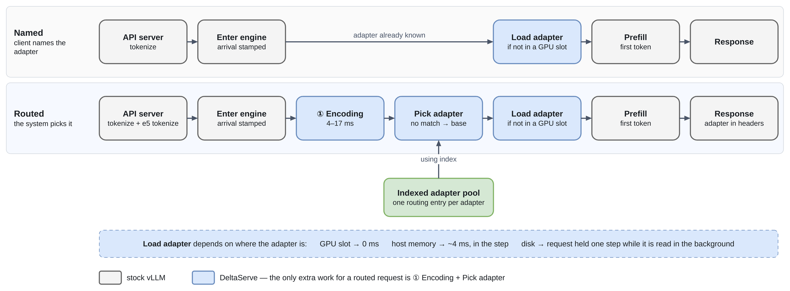
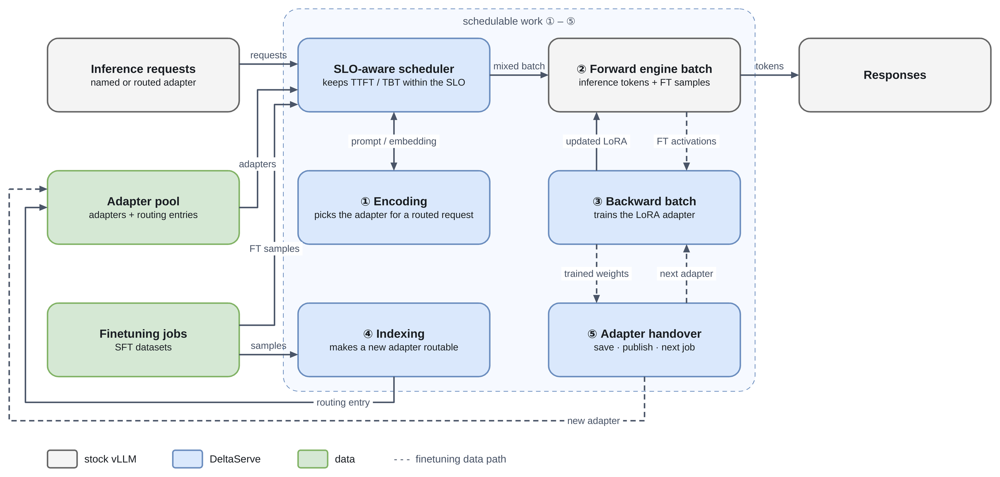
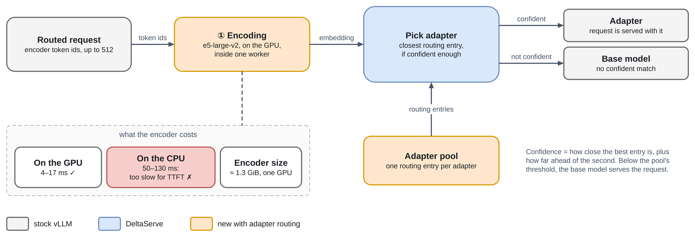
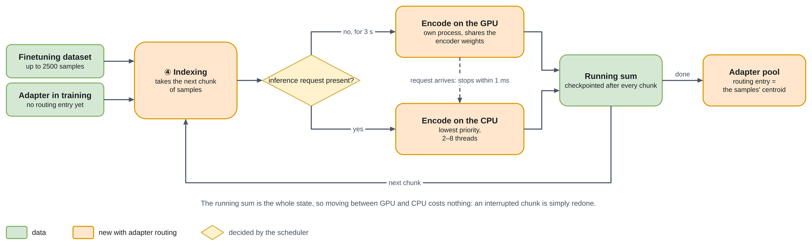
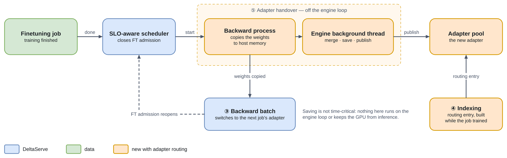
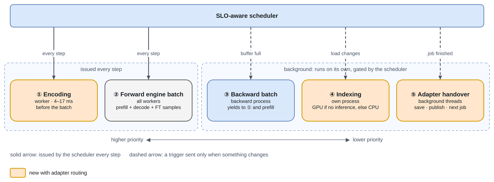
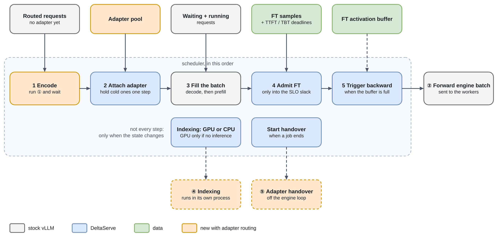
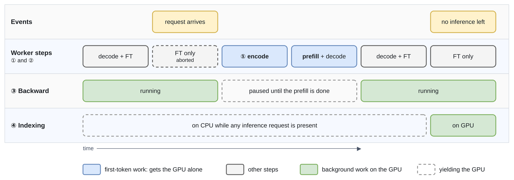

# Adapter routing under one scheduler

How DeltaServe serves a request whose LoRA adapter is chosen by the system
("adapter routing"), and how every piece of extra work this needs is decided by the
SLO-aware scheduler at step granularity.

This is a walkthrough of the design as implemented (merged from the `adapter-routing` branch).
Timings marked *measured* come from Qwen3-14B TP=2 on 2× RTX 5090. What is not done
yet is listed in section 10. Figure sources (`.drawio`) are in
[`figures/scheduling/`](figures/scheduling/).

## 1. Request path: what adapter routing costs

A **named** request already says which adapter it wants. A **routed** request leaves
the choice to the system, which adds two steps between entering the engine and the
prefill:

- **Encoding** — the prompt is embedded by a small encoder (e5-large-v2) on the GPU.
  Measured ≈ 3.5 ms + 0.014 ms × total tokens, 4–17 ms for typical batches.
- **Pick adapter** — the embedding is compared against the **indexed adapter pool**
  (one routing entry per adapter). No match, or an encode failure, falls back to the
  base model.

Everything else is shared. The API server tokenizes (for a routed request it also
runs the encoder's tokenizer) and forwards at once; the arrival time is stamped when
the request reaches the API server, so the time spent choosing the adapter counts
against TTFT. The encoder's tokens travel into the engine with the request, and the
decision comes back with its first output — both in the request's `trace_headers`,
no extra channel. The chosen adapter is reported in the response headers (the
body's `model` field is the base model's name); for a streamed response the headers
are sent with the first token, because vLLM submits a streamed request to the engine
only after the response has started.

**Load adapter** applies to both paths and depends on where the adapter is: a GPU
slot (0 ms), host memory (≈ 4 ms, inside the step), or disk (the request is held one
step while the adapter is read in the background).

## 2. DeltaServe before adapter routing

DeltaServe co-serves LoRA finetuning with inference on the same GPUs. FT samples ride
inside the inference batch; their activations are saved during the forward; a
backward process trains the adapter from them and pauses whenever inference needs
the GPU. The SLO-aware scheduler admits FT samples only while TTFT / TBT stay within
the SLO.

Here the scheduler has two things to decide: what goes into the forward batch, and
when the backward may run.

## 3. Adapter lifecycle: from training to being routed to

Adapter routing closes a loop. A finetuning job's samples go through the forward
batch (1), their activations are saved (2), and the backward trains the adapter (3).
**In parallel**, indexing reads the same dataset and builds the adapter's routing
entry while the job trains. When the job finishes, the **adapter handover** saves and
publishes the adapter into the pool (4), where its routing entry is already waiting
or arrives shortly after. From then on it is a candidate for routed requests (5),
which are served with it (6).

The loop introduces three kinds of work that did not exist in section 2: encoding,
indexing, and the adapter handover.

## 4. DeltaServe with adapter routing

The same picture with the loop added. Inputs are on the left (inference requests,
the adapter pool, finetuning jobs), responses on the right, and everything in between
is work the scheduler decides. Orange marks what is new compared with section 2:
the adapter pool, encoding, indexing and the adapter handover. The figures that
follow keep this colour for the four of them.

The principle: **anything that occupies the GPU or the engine loop is decided by the
scheduler.** Nothing takes GPU time on its own initiative.

### 4.1 Encoding

Encoding turns a routed request into an adapter choice.

- **Input** — the request's prompt, already tokenized for the encoder by the API
  server (up to 512 tokens).
- **Encoder** — e5-large-v2, about 1.3 GiB of weights, loaded once inside the worker
  of one GPU.
- **Cost** — 4–17 ms on the GPU (*measured*: ≈ 3.5 ms + 0.014 ms × total tokens). On
  the CPU the same encode takes 50–130 ms, all of which lands on TTFT, so requests
  are encoded on the GPU (`router_device: cpu` exists for experiments only).
- **Output** — one embedding per request.
- **Choosing the adapter** — the embedding is compared with every routing entry in
  the pool. The confidence combines how close the best entry is with how far ahead
  of the second-best it is; above the pool's threshold the request gets that
  adapter, below it the base model.

### 4.2 Indexing

Indexing makes an adapter routable by computing its routing entry.

- **Input** — an adapter's finetuning dataset (up to 2500 samples). It starts with
  the finetuning job and runs alongside training; it does not wait for the adapter.
- **What it does** — encodes the samples in small chunks with the same encoder and
  keeps a running sum of the embeddings; the routing entry is their centroid.
- **Where it runs** — the scheduler decides. While no inference request has been
  present for 3 s it runs on the GPU, in a process of its own that shares the
  encoder's weights with the worker (no second copy). Otherwise it runs on the CPU
  at the lowest priority, with 2–8 threads.
- **Switching** — when a request arrives, the GPU process stops at its next encoder
  layer, under a millisecond away, and the same chunk is redone on the CPU. The
  running sum is checkpointed after every chunk and is the job's whole state, so
  moving in either direction costs nothing but the interrupted chunk.
- **Output** — the routing entry, added to the adapter pool.

### 4.3 Adapter pool

The pool holds the adapters, one routing entry per active adapter, and where each
adapter currently is. Only active adapters are candidates for routed requests; a
retired one is still served when named. Load cost by location (*measured*):

| Location | Cost | How it is scheduled |
|---|---|---|
| GPU slot | 0 ms | — |
| host memory | ≈ 4 ms | loaded at step start |
| disk, other work pending | ≈ 12 ms read in the background, then ≈ 6 ms | request held one step |
| disk, nothing else to do | ≈ 18 ms | loaded in-step |

GPU slots follow vLLM's own LRU. The engine does not choose victims and pins
nothing but the finetuning adapter: it replays vLLM's two caches (host memory, GPU
slots) from the adapters of every step it issues, and that replay is where the pool,
the scheduler and `GET /adapters` read an adapter's location from. Active adapters
fit in host memory (`max_cpu_loras` is raised to hold them), so the disk path is
taken only on a cold start. A new adapter is not registered with vLLM up front
either: it is read in the background with the next step and loaded when a request
first uses it.

Attaching an adapter to a request after it entered the engine has one consequence
that is easy to miss: vLLM keys its prefix-cache blocks by adapter and computed them
when the request was built, without one. The block hashes are recomputed when the
adapter is attached — otherwise a routed request would reuse the KV the *base* model
computed for the same prompt.

### 4.4 Adapter handover

When a finetuning job finishes, its adapter has to be saved and the backward has to
move on to the next job. None of it runs on the engine loop: the engine has a direct
line to every rank's backward child (a socket per child, next to its command pipe),
and an engine background thread does the talking.

- **Save and publish** — each backward child copies its rank's trained weights to
  host memory and writes its shard; the background thread merges the ranks, writes
  the adapter and publishes it into the adapter pool, next to the routing entry that
  indexing built while the job trained. *Measured:* done about 125 ms after the
  job ends, engine loop held 0 ms (200–290 ms when the engine did it itself).
- **Switch** — only after the previous job is saved and published does the next
  job start: the thread asks every rank's child to *check* the new adapter, and only
  when all agree to *take* it (the child reads the file itself). *Measured:* 49 ms,
  engine loop held 0 ms. The scheduler then takes the new dataset and reopens FT
  admission.

FT admission needs no explicit gate during the handover: the finished job has no
samples left, and the next job's dataset is installed only when the switch is done.
If the children are not listening, both steps fall back to worker calls (22–34 ms on
the engine loop).

## 5. Schedulable objects

Reading the work off the overview gives five schedulable objects:

| | Object | What it is | When it may run |
|---|---|---|---|
| ① | Encoding | embed routed prompts, pick adapters | its own step, before the batch; capped by total tokens |
| ② | Forward engine batch | decode + prefill + FT samples; adapter load at step start | every step |
| ③ | Backward batch | one backward pass of the adapter being trained | any time except encode steps and steps with inference prefill |
| ④ | Indexing | compute a new adapter's routing entry | on the GPU only when no inference request is present; otherwise on the CPU |
| ⑤ | Adapter handover | save, publish, switch to the next job | off the engine loop; no FT runs between two jobs |

## 6. Where everything runs

With *n* GPUs under tensor parallelism, each GPU holds one worker and its backward
child. The encoder lives in the worker of **one** rank, so an encode is an ordinary
worker call and can never overlap a model step. Indexing is a separate process that
shares the encoder's weights with that worker when it runs on the GPU, and has a
CPU process to fall back to. Adapters sit in one of three places — GPU slot, host
memory, disk — which is what the load cost in section 4.3 depends on.

## 7. One scheduling step

A step, in order: encode the routed requests that are waiting, pick their adapters,
load what the batch needs, run the forward batch, then let the backward use what is
left. The backward is paused only for the two step kinds that are latency-critical
for a new request — an encode step and a step containing inference prefill — and
resumes as soon as the prefill completes. A decode-only step does not pause it.

Two more decisions sit in the scheduler but are not part of building the batch, and
are taken only when the state changes: whether indexing may use the GPU, and when to
start an adapter handover. Indexing and the handover then run on their own, outside
the engine loop.

## 8. Scheduler decisions

The decisions in the order the scheduler takes them, with the batch contents shown
alongside as they grow:

1. **Adapter routing** — routed requests in the queue get an encode step and an
   adapter; named requests skip it.
2. **Adapter location** — on disk: the request goes back to the queue for one step
   while the adapter is read in the background (if there is no other work, it is
   scheduled directly and loaded in-step instead). In host memory: load into a GPU
   slot at step start. In a GPU slot: nothing to do.
3. **Backward pause / resume** — pause for an encode step or a prefill step, resume
   otherwise.
4. **FT admission** — add FT samples only while the predicted TTFT / TBT stay within
   the SLO; there is nothing to admit while an adapter handover is in progress.
5. **Indexing** — allowed on the GPU only when no inference request is present; the
   scheduler notifies the indexing process only when this changes.
6. **Adapter handover** — when a job finishes, start the handover off the engine
   loop; the next job's samples are admitted once it has switched.

## 9. Inference first

Every object other than the forward batch yields to inference. The backward yields
at each of its boundaries, indexing yields between encoder layers and moves to the
CPU, and the handover does its GPU part (copying weights to host memory) in the
backward child and everything else on the CPU. The estimator is told what adapter
routing cost: the encode time is already inside TTFT because the arrival is stamped
before it, it is added explicitly to TBT (the worker's own time for the encode —
not the engine's wall time, which also holds the wait for the step still on the
GPU), and the predicted adapter load time is
added to the step time (and taken off the measured step time before the model is
refitted, so loads do not skew it).

Requests the engine is holding — waiting for their encode step, or for a cold
adapter — are outside vLLM's queues. They count as pending work, so the engine loop
does not go idle on them, and a client that disconnects removes its request from
there too.

## 10. Measured, and not done

**Production trace** (Qwen3-14B TP=2, vLLM 0.33, `production-600-800`, 534 streamed
requests, finetuning co-serving throughout; every run 534/534):

| | preset | runs | TTFT p50 / p95 / p99 | avg TBT p50 | FT tokens trained |
|---|---|---|---|---|---|
| adapter routing off | plain (0.4 s / 50 ms) | 2 | 68 / 81–82 / 88–89 ms | 20.3–20.4 ms | 118.5–119.6k |
| requests name their adapter | routing (0.5 s / 35 ms over 1 s / 70 ms) | 3 | 70–72 / 99–100 / 103–105 ms | 23.4–23.9 ms | 127.8–129.1k |
| routed | routing | 3 | 85–86 / 104 / 107–109 ms | 24.8–25.7 ms | 122.4–122.9k |

Choosing the adapter costs a routed request about 15 ms of TTFT at the median (4 ms
at p99), 1.5–2 ms of average TBT and 4–5 % of the finetuning throughput. With
adapter routing off, performance and GPU memory are those of the code without this
feature (same harness, two runs each). The four pool adapters share one set of
weights and their routing entries were built from the trace's own prompts, so this
measures the path, not the quality of the choice.

Two indexing jobs added mid-trace (400 samples each) left the routed numbers
unchanged (TTFT 85 / 103 / 108 ms, 124.3k FT tokens); the first took 27 s, mostly
while requests were present, the second 1.6 s on the GPU in a gap. A finetuning job
indexed from the start (64k tokens) ended 75.8 s into the 184 s trace, was saved in
152 ms off the engine loop, admitted, listed by `GET /adapters/available` 0.26 s
after training ended and used by the client from its next request, without a cold
start.

Seen in these runs: 614 encode steps of one request each (7 ms each on the GPU, plus
14 ms of waiting for the step in flight), the backward paused for an encode 267
times and every time kept for the prefill that followed, 2 cold-start holds (both
preloads used). Never seen live, covered by unit tests only: an encode batch split
by the token cap, a pause released because no prefill followed, GPU indexing
preempted by a request.

**Next to the rest of DeltaServe** (things this walkthrough does not schedule):

- *Adapter checkpoints* (`POST /save_adapter`, periodic and per-epoch saves) are a
  second way to write the adapter being trained: the backward children gather
  their shards to rank 0 over their own process group and rank 0 writes the file.
  The handover of section 4.4 does not use it (each rank writes its shard, the
  engine merges them on the CPU). Both read the same masters and the same key
  names. A per-epoch checkpoint and a job's handover falling on the same moment
  has no test yet; no preset turns both on.
- *Telemetry and `dserve-top`* do not know the encode step, indexing or the
  handover: their GPU time split has no entry for them, and the ADAPTERS panel
  shows vLLM's LoRA state in the workers, not the adapter pool.
- *The admission margin* (`slo.admission_margin`) scales the predicted step time;
  the adapter load and encode times are added outside it.

**Not done:**

- the adapter load cost comes from configuration constants (4.5 ms / 13.5 ms,
  measured once), not from the launch profiling pass;
- indexing has two levels (no inference / inference present); a third one that
  backs the CPU indexer off when the SLO margin is small does not exist;
- recovery when the second phase of an adapter switch fails on one rank (the job
  fails and asks for a restart);
- an indexing process that died is retried every 30 s instead of being given up on;
- the `validation` stage; calibration of the routing threshold on a real pool of
  distinct adapters.

