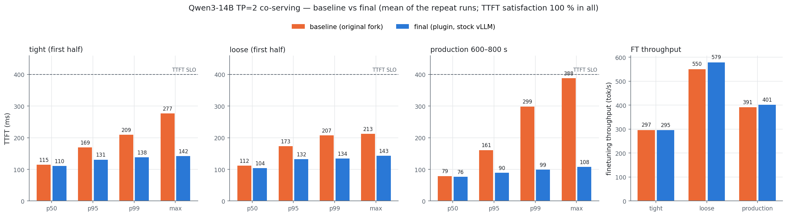
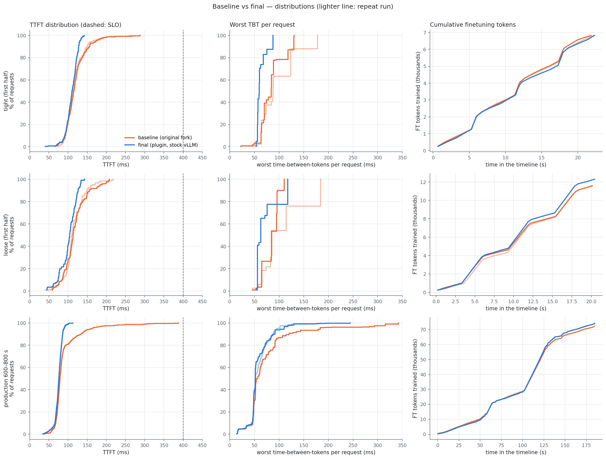

# Results

Qwen3-14B-Base, TP=2 on 2× RTX 5090, co-serving the shipped preset
(`configs/preset/serving_config_finetuning_qwen3_14b_tp2.yaml`), TTFT SLO 0.4 s. Three
inference workloads replayed from recorded traces:

| Workload | Requests | Span | Rate |
|---|---|---|---|
| tight-half | 240 | 22 s | ~11 req/s |
| loose-half | 120 | 20 s | ~6 req/s |
| production-600-800 | 534 | 184 s | ~2.9 req/s (production trace slice) |

The baseline is the original patched-fork implementation. The final version is
this plugin on stock vLLM. Each figure is the mean of two runs.

| Workload | TTFT p99, baseline → final | FT throughput, baseline → final | TTFT SLO satisfaction |
|---|---|---|---|
| tight-half | 201 → **137 ms** | 297 → 295 tok/s | 100 % → 100 % |
| loose-half | 204 → **134 ms** | 550 → **579** tok/s | 100 % → 100 % |
| production-600-800 | 295 → **~100 ms** | 391 → **401** tok/s | 100 % → 100 % |

Reproduce with `eval-tp/cleanup_validate.sh` (see [Running experiments](../README.md#running-experiments)).

**vLLM v0.33.0 (current pin) vs the previous pin (117afeea4)**, same plugin and preset:

| Workload | TTFT p50 | TTFT p99 | FT throughput | TTFT SLO satisfaction |
|---|---|---|---|---|
| tight-half | 110.5 → **102.9 ms** | 138 → 143 ms | 295 → **360 tok/s (+22 %)** | 100 % → 100 % |
| loose-half | 104.2 → **87.8 ms** | 134 → 135 ms | 579 → **626 tok/s (+8 %)** | 100 % → 100 % |
| production-600-800 | 76.1 → **68.9 ms** | 99.8 → **89.3 ms** | 401 → **460 tok/s (+15 %)** | 100 % → 100 % |

vLLM itself got faster (decode step 18.3 → 14.9 ms, prefill 40 → 36 ms) and its CUDA
graphs use 6.8 → 4.0 GiB, leaving ~15 % more KV cache. One regression, upstream and not
FT-specific: the host dispatch of piecewise prefill steps grew 2 → ~20 ms (inference-only
prefills too); async scheduling hides it.
