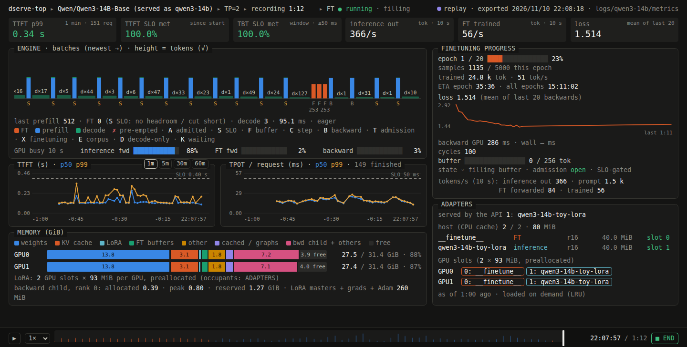

# Telemetry and live monitoring (`dserve-top`)

The full reference for the telemetry recorder and the `dserve-top` dashboard; the
[README](../README.md#telemetry-and-live-monitoring-dserve-top) has the short version.

Two layers. The server records **system metrics**: per-request latency, per-cycle
backward stats, 10-second summaries, GPU memory and a per-step log. Turn it on with
`telemetry.metrics_dir`, or at runtime from `dserve-top`. On top of that feed,
**`dserve-top`** is a live web dashboard. It shows what the engine is doing step by
step, inference latency against the SLO, finetuning progress, throughput, adapters
and GPU memory. You can scrub back through the run, download it as one HTML file
that replays offline, and stop the server from it.



The same run as an exported file: [`dserve-top-example.html`](dserve-top-example.html)
(53 KB, 72 s of Qwen3-14B TP=2 at about 3 req/s with finetuning running). Download it and
open it in a browser; it replays with no server: scrub the timeline, press `▶`, hover anything.

## Recorded system metrics

Set `telemetry.metrics_dir` (the templates do: `logs/<model>/metrics`) and the server
records, from the moment it starts:

| File | One row per | Holds |
|---|---|---|
| `requests.csv` | finished inference request | TTFT, mean / max time between tokens, end-to-end latency, prompt / output tokens |
| `backward.csv` | LoRA backward cycle | GPU time, wall time (incl. pauses while inference has the GPU), tokens, samples, loss, the backward child's GPU memory |
| `summary.jsonl` | `metrics_interval_s` window (10 s) | TTFT / TBT p50 / p90 / p99 / max and SLO attainment; inference and FT token throughput; forward GPU time by step kind (inference-only / mixed / FT-only) and its inference vs FT share; backward GPU time; memory; run totals |
| `memory_rank<r>.json` | GPU (written after warm-up) | model weights, KV cache, FT activation buffers, other allocations, CUDA-graph / cached memory, device total and used |

`GET /system_metrics` returns the last window and the one in progress, and

```bash
python scripts/metrics_report.py logs/qwen3-14b/metrics --png report.png
```

prints a run report (latency, throughput, LoRA step time, GPU time split, memory per
GPU) and draws TTFT per request, throughput, GPU busy time and memory.

How it is measured: request times are taken in the EngineCore (arrival = the
frontend's stamp, a token = the step that produced it), so they exclude HTTP and
detokenization — measured against a client, about 1 ms lower. A request's TTFT
counts in the window where its first token came out (live in `GET /system_metrics`
at once), not when the request finishes; `requests.csv` gets the full row at the
finish. Step GPU times are the
runner's CUDA-event samples (the ones the SLO estimator fits on); in a mixed step the
time is split between inference and FT by token count. The backward child shares the
GPU (time-sliced), so forward and backward GPU seconds can overlap: each share is of
that side's own busy time. Inter-token gaps go into 2 %-wide buckets, so their
percentiles are within 2 % (mean, max and SLO attainment are exact). The cost is
about 75 µs per 256-request step, writes happen on a background thread, and the window
in progress is written when the server is asked to stop.

## Overhead

Recording costs **0.05 % of the engine thread on Qwen3-14B TP=2** and about 0.6 % on the
host-bound Qwen3-0.6B. It has no measurable effect on throughput, decode latency or
finetuning; the one visible change is **+1.6–1.8 ms on the median TTFT on 0.6B** (none
measurable on 14B). A `dserve-top` attached and polling adds nothing measurable on top.

Measured with `eval-tp/bench_metrics_overhead.py --order ABTTBA --num-prompts 2400` on
Qwen3-0.6B (one RTX 5090, CUDA graphs): six interleaved runs, two each of recording off
(B), recording on (A), and recording on with `dserve-top` polling the server (T), under
the same closed-loop load (`vllm bench serve`, 32 concurrent, 512 tokens in / 128 out,
~56 req/s, 2400 requests) with finetuning running. The 0.6B engine is host-bound
(~2.3 ms steps), so engine-thread overhead shows most here: a worst case for larger
models.

| Δ vs recording off (mean of 2 runs) | recording on | + `dserve-top` |
|---|---|---|
| throughput (req/s, output tok/s) | +0.3 % | +0.5 % |
| TPOT p50 / p99 | −0.2 % / −9 % | −0.2 % / −10 % |
| ITL p50 / p99 | −0.1 % / −1.3 % | −0.0 % / −1.0 % |
| FT tokens/s | −1.8 % | −0.4 % |
| TTFT p50 | +3.2 % (56.3 → 58.1 ms) | +2.8 % (→ 57.9 ms) |
| TTFT p99 | noise: 80–136 ms across all six runs, no consistent sign (off 112 / 122, on 136 / 129, with `dserve-top` 106 / 80) | |
| recorder CPU on the engine thread | 0.57 %, 17 µs per step | 0.58–0.59 %, 15–16 µs per step |

Where the time goes (every recorder call timed in the EngineCore): per step ~5 µs for
token / request bookkeeping and ~9 µs for the step record and the live feed; each
`dserve-top` poll (~4/s) is answered in ~80 µs, and its memory / adapter snapshot every
10 s in ~90 µs; the slowest single call 0.3 ms. Files are written on a background thread.

Disk: at this load (56 req/s) the recording grows ~17 MB per hour, mostly `requests.csv`
(one row per request); the step log is ~0.7 MB per hour (plain decode steps fold into one
entry) and is capped by `telemetry.steps_log_max_mb` (256 MB, rolling). `dserve-top` keeps
its history in RAM up to `--history-hours` (12 h); an export is ~0.65 MB per hour of run
(Qwen3-14B TP=2 at 3 req/s).

On **Qwen3-14B TP=2** (2× RTX 5090; same six-run protocol, 16 concurrent, 512 / 128
tokens, 1200 requests per run, finetuning running; the server is saturated, so TTFT is
mostly queueing) the engine is GPU-bound and the cost all but disappears:

| Δ vs recording off (mean of 2 runs) | recording on | + `dserve-top` |
|---|---|---|
| throughput | −0.15 % | −0.11 % |
| TTFT p50 / p99 | +0.24 % / +0.73 % | +0.01 % / +0.49 % |
| TPOT p50 / p99 | +0.13 % / +0.16 % | +0.12 % / −2.9 % |
| ITL p50 / p99 | +0.02 % / +0.32 % | +0.07 % / +0.06 % |
| FT tokens/s | −1.5 % | +0.1 % (noise: the off runs differ by 2.6 %) |
| recorder CPU on the engine thread | 0.05 %, 14 µs per step | 0.10 %, 25 µs per step (the polls) |

## `dserve-top`: quick start

`dserve-top` is installed with the plugin (`pip install --editable deltaserve-plugin`
puts it on the `PATH` of that env; `python -m deltaserve.top` is the same thing). It
is standard library only: it does not import vLLM and starts instantly.

**1. On the GPU machine**, in the env that has the plugin, next to the server:

```bash
dserve-top                                     # server at 127.0.0.1:8000, page on :8090
dserve-top --server http://127.0.0.1:8001     # another port
```

The order does not matter: start it before the server and it waits; restart the
server and it reconnects.

**2. On your laptop**, open the SSH tunnel that `dserve-top` printed. It is filled
in from your SSH session (user, address, port):

```bash
ssh -N -o ExitOnForwardFailure=yes -L 8090:localhost:8090 -p 2222 you@gpu-box
```

**3. In your laptop's browser**, open <http://localhost:8090>.

When it works, `dserve-top` prints `a browser opened the dashboard (via …)`.
`Ctrl-C` quits; it stops the recording if it started one.

## Opening the page over SSH

The page is served on `127.0.0.1` of the GPU machine only (nothing is exposed on the
network), so you reach it through an SSH tunnel. The first thing `dserve-top` prints
is a step-by-step guide built from `$SSH_CONNECTION` (the address and port you
logged in through):

```
  1. On your LAPTOP (a new local terminal, not this SSH session), run:
       ssh -N -o ExitOnForwardFailure=yes -L 8090:localhost:8090 -p 2222 you@100.102.161.15
  2. In your laptop's browser open:   http://localhost:8090
     Check from the laptop without a browser:  curl -s http://localhost:8090/healthz
```

- **The tunnel command prints nothing.** That is normal: `-N` means "tunnel only,
  no shell". Leave it running. `ExitOnForwardFailure=yes` makes it exit with an
  error if the local port is taken, instead of staying up without a tunnel. Add
  `-v` to watch it connect.
- **Check the tunnel without a browser:** `curl -s http://localhost:8090/healthz`
  answers `dserve-top OK · server connected` (or why it is not connected).
- **Local port 8090 is taken on the laptop:** forward another local port, e.g.
  `-L 18090:localhost:8090`, and open `http://localhost:18090`.
- **Through a jump host:** add `-J <jump-host>`, or use your `~/.ssh/config`
  alias: `ssh -N -L 8090:localhost:8090 <alias>`.
- **VS Code Remote-SSH:** Ports panel → Forward a Port → `8090` → open the local
  address.
- **On the GPU machine's own desktop:** open <http://127.0.0.1:8090> directly.
- **Port 8090 busy on the GPU machine:** `dserve-top` takes the next free port and
  the guide uses it; `--port` picks one.

Any number of browser tabs can be open: `dserve-top` polls the server once, about
four times a second, and every tab reads from its buffers.

## What `dserve-top` does to the server

The dashboard needs the server's telemetry recording. `dserve-top` handles that:

| The server… | dserve-top |
|---|---|
| is not up yet | serves the page ("waiting for the DeltaServe server …") and keeps trying every 2 s; `--no-wait` exits instead |
| records telemetry already (`telemetry.metrics_dir` in its config) | attaches to it and leaves it running on exit |
| does not record | starts a recording at runtime (`POST /telemetry/start`) into `--dir` (default `./dserve-top/<time>`, on the GPU machine), and stops it on exit unless `--keep-recording` |
| goes away | keeps the history (you can still scrub and export), says "lost the server", and waits |
| comes back (restart) | starts recording again; the page starts a fresh history for the new run |
| has finetuning off, or an old plugin | says it has no `/telemetry` routes |

The recording is the [system metrics](#recorded-system-metrics) set (`requests.csv`,
`backward.csv`, `summary.jsonl`, `memory_rank<r>.json`) plus the rolling step log
`steps.*.jsonl.gz`. It costs well under 1 % of the engine thread (measured in
[System metrics](#recorded-system-metrics)). Every 10 s `dserve-top` also asks for a fresh
per-GPU memory and adapter snapshot (`POST /telemetry/memory`) and reads
`/v1/models`, so adapters loaded on demand show up.

## `dserve-top` options

| Flag | Default | Meaning |
|---|---|---|
| `--server URL` | `http://127.0.0.1:8000` | the DeltaServe server |
| `--port N` | `8090` (next free) | dashboard port on the GPU machine |
| `--bind ADDR` | `127.0.0.1` | address to serve on; keep it local and use the SSH tunnel |
| `--dir PATH` | `./dserve-top/<time>` | where the server records, if `dserve-top` starts the recording |
| `--interval S` | `10` | summary window (`summary.jsonl`) of a recording started here |
| `--keep-recording` | off | leave a recording `dserve-top` started running after it quits |
| `--poll S` | `0.25` | seconds between polls of the server |
| `--history-hours H` | `12` | how far back the page can scrub, kept in `dserve-top`'s memory |
| `--no-wait` | off | exit with an error if the server is not reachable now |

## Reading the page

The page refreshes about three times a second and scales itself to the window
(0.75× to 2.4×): it fills the width and fits the height, so it never scrolls and
nothing is cut short; a window under 1000 px wide gets the plain stacked layout. The only button that changes
the server is `■ STOP`.

| Panel | Shows |
|---|---|
| Header | model, TP size, how long it has been recording, FT state (running · backward / filling, stopped, disabled: hover for why), connection, recording dir (hover for the full path) |
| At a glance (top row) | TTFT p99 over the last minute (green / red against the SLO), TTFT SLO met since start, TBT SLO met this window, inference and FT tokens/s (last 10 s), loss |
| Engine | every engine step as a bar, newest on the right: FT (bottom), inference prefill, decode tokens, on a √ scale. Runs of plain decode steps fold into one growing `d×N` block. Under each bar: the FT admission decision (table below) and the FT tokens admitted. `✗` = an FT-only step pre-empted for an arriving request. Hover a bar for its GPU ms, CUDA graph / eager, backward running / paused. Below: the last step, and GPU busy over the last 10 s for inference forward, FT forward and LoRA backward (hover for how it is measured) |
| TTFT, TPOT | side by side: p50 / p99 per second against the SLO line (TTFT counted when the first token comes out; TPOT per finished request); range 1 (default) / 5 / 30 / 60 min |
| Finetuning progress | epoch and progress through it, samples, tokens trained and tokens/s, ETA for the epoch and all epochs, loss curve, backward GPU / wall ms and paused share, cycles, buffer fill, admission open / closed, estimator fitted; tokens/s over the last 10 s: inference output and prompt, FT forwarded and trained |
| Adapters | adapters served by the API; the host (CPU) adapter cache with each adapter's role (FT / inference), rank, size and whether it sits in a GPU slot or host only (pinned = the FT adapter); each GPU's LoRA slots and what is in them |
| Memory | one bar per GPU: weights, KV cache, LoRA adapter slots, FT buffers, other, cached / CUDA graphs, backward child + other processes, free. Below: the LoRA slot size and the backward child's memory (allocated / peak / reserved, LoRA masters + grads + Adam) |

FT admission codes under the engine bars (`ADMIT_CODES` in `ft_scheduler.py`):

| Code | Meaning |
|---|---|
| `A` | admitted |
| `S` | SLO: no latency headroom, or cut short |
| `F` | buffer: admitted what fit, or full |
| `C` | step token budget: admitted what fit, or none left |
| `B` | backward running (the buffer is being trained) |
| `T` | admission closed (throttle, or epoch flush) |
| `X` | finetuning not started or disabled |
| `E` | corpus finished |
| `D` | decode-only step (admission phase `prefill`) |
| `K` | waiting for prefill credit (`match_prefill_workload_factor`) |

Request times are measured in the engine, about 1 ms below what a client sees.
Forward and backward share the GPU, so their busy fractions can add up to more
than 100 %.

## Going back in time

The bar at the bottom of the page covers the whole history `dserve-top` holds (the
last `--history-hours`). Behind the slider is a strip of inference load (blue) and FT
load (orange), with red ticks on the seconds where the TTFT p99 broke the SLO, so
the bad moments are easy to find.

| Do | To |
|---|---|
| drag the slider, or click on it | show that moment in every panel: the batches up to it, the charts ending at it, FT status, memory and adapters as they were |
| `←` / `→` (`Shift`: 1 min) | step 5 s back / forward |
| `Home` | jump to the start of the history |
| `▶` (`Space`), speed 1× / 10× / 60× | play from the cursor; from live it starts 5 min back |
| `⏭ LIVE` (`End`) | jump back to the newest data and follow it again (`● LIVE`) |
| `■ STOP` | stop the server, as `Ctrl-C` on the launcher would (asks first). In-flight requests are dropped; the estimator state and telemetry are saved; `dserve-top` keeps running with the history. Works only when `dserve-top` runs on the server's machine |

While you look at the past, data keeps arriving in the background. The label shows
the cursor's time and how far behind live it is (`−mm:ss`).

When the server stops, the history stays: scrub and export as long as `dserve-top`
runs (reloading the page reloads the history). It is reset only when a new server
run connects, so export first if you restart the server.

## Exporting a run

**`⤓ HTML`** downloads the history as one self-contained HTML file: the page with
the data gzip'd and embedded. Open it anywhere, offline, with no server and no
`dserve-top`. It replays with the same scrubber and says `replay · exported <time>`
in the header. Attach it to an issue, mail it, or keep it next to the results.

The file is capped at **50 MB**. Above that, the oldest part is dropped and the
newest kept. The button shows the current size estimate.

| Load | Per second of run | 12 h (default history) | 50 MB holds |
|---|---|---|---|
| Qwen3-14B TP=2, 3 req/s, FT running (measured) | ≈ 0.18 KiB | ≈ 8 MB | ≈ 75 h |
| busier: ~6× the non-decode steps | ≈ 0.6 KiB | ≈ 26 MB | ≈ 20–30 h |

Most of it is the step stream (65 B/s gzip'd at the measured load), then the
per-second rows (51 B/s) and status snapshots every 2 s (23 B/s); base64 adds a
third. Plain decode steps fold into one entry, so a quiet server costs almost
nothing. With the default 12 h history the cap rarely matters; it applies with a
long `--history-hours` on a busy server.

From the command line, the same file:

```bash
curl -o run.html http://localhost:8090/api/export            # ≤ 50 MB
curl -o run.html "http://localhost:8090/api/export?max_mb=10"
```

## `dserve-top` troubleshooting

| You see | Means / do |
|---|---|
| the tunnel command prints nothing | normal (`-N`); test it with `curl -s http://localhost:8090/healthz` on the laptop |
| `bind [127.0.0.1]:8090: Address already in use` (tunnel exits) | the laptop's port 8090 is taken: `-L 18090:localhost:8090`, open `:18090` |
| browser: connection refused | the tunnel is not running, or `dserve-top` is not; `/healthz` tells which |
| header: waiting for the DeltaServe server | the server is not up (yet) at `--server`; `dserve-top` connects when it is |
| `… has no /telemetry routes` | the server runs with finetuning off (`finetune_param.enable_finetuning`) or an old plugin |
| `could not start recording` | the server could not create `--dir` (permissions, disk); pass another `--dir` |
| `dserve-top: command not found` | not in the plugin's env: activate it, or `python -m deltaserve.top` |
| memory / adapters panels say waiting | the first per-GPU snapshot comes within ~10 s of connecting |

## Under the hood: the feed and the endpoints

| Endpoint | Of | Returns |
|---|---|---|
| `/` | dserve-top | the page (`deltaserve/top_page.html`) |
| `/api/state?steps_since&series_since&snaps_since&mems_since&models_since` | dserve-top | what is new since the page's last poll; the first poll gets the whole history (gzip'd) |
| `/api/export?max_mb=50` | dserve-top | the single-HTML export |
| `POST /api/stop` | dserve-top | the `■ STOP` button: forwards to the server's `POST /shutdown` (needs the header `X-DServe-Stop: 1`) |
| `/healthz` | dserve-top | `dserve-top OK · server connected` / not connected (why) |
| `GET /telemetry/data?steps_since&series_since` | server | the live feed: steps since a sequence number, per-second rows since a time, current window, FT status |
| `POST /telemetry/start` / `stop` / `memory` | server | start / stop a recording at runtime; refresh the per-GPU memory and adapter snapshot |
| `POST /shutdown` | server | SIGINT to the API server, so vLLM shuts down as on `Ctrl-C`; loopback clients only (403 otherwise) |

On the server, `live.LiveFeed` inside the telemetry recorder builds the step stream
(plain decode steps folded into `d×N` runs; FT admission codes stamped by
`admit_ft_to_step`) and the per-second rows. While it records, the step stream is
also written to `steps.*.jsonl.gz` in the recording dir, rolling under
`telemetry.steps_log_max_mb` (256 MB).
